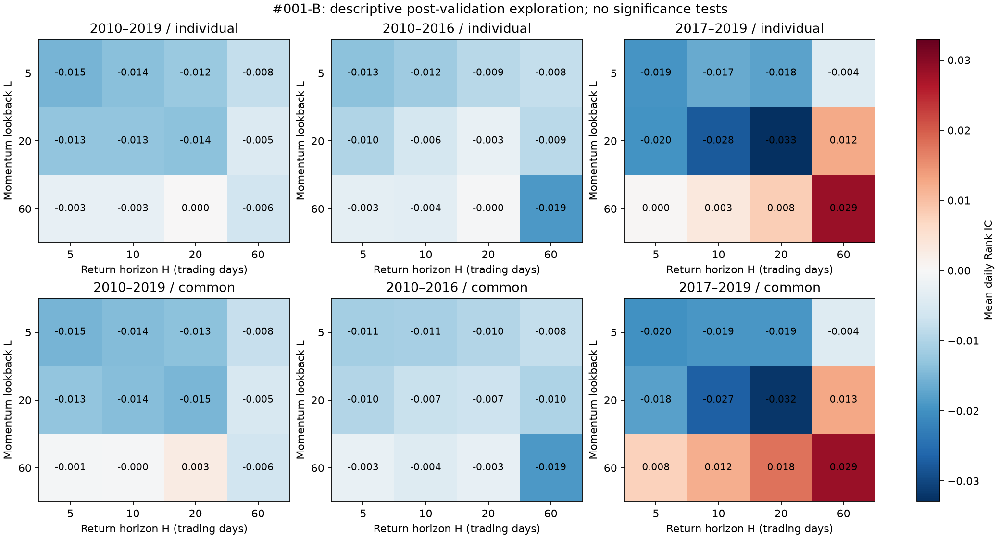
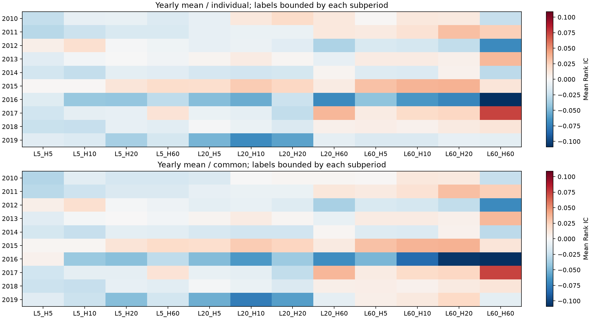
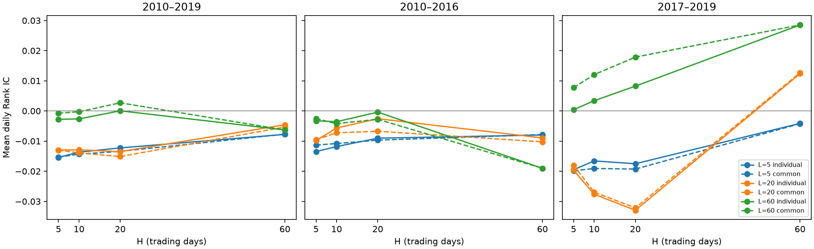

# Momentum Research #001-B: Prediction Horizon Analysis

**Post-validation descriptive exploration.** #001-A and its frozen, unexecuted final-test protocol are preserved. 2017–2019 is already-seen data, not fresh validation. No 2020–2025 price payloads, IC or quantile outcomes are read or calculated.

## Fixed methodology

Original frozen 300-security universe; adjusted Yahoo Close snapshot. L ∈ {5,20,60}; H ∈ {5,10,20,60}; factor P[t]/P[t−L]−1; target P[t+1+H]/P[t+1]−1. Signals are available after close; shifts count observed trading rows. Daily Spearman correlations use average ranks after pairwise deletion, at least 100 pairs and nonconstant cross sections. Dates are equally weighted. Standard deviation uses ddof=1; ICIR is mean/std, unannualized; positive fraction counts IC>0.

For each period, retain up to 60 preceding observed price rows only for factor warm-up. No fill or calendar imputation. If pre-period history is unavailable, initial factors remain missing. Labels are constructed on that period alone; the last H+1 rows have no eligible exit. Intermediate missing prices do not invalidate endpoint-only formulas. The pooled 2010–2019 panel can cross 2016/2017; separately recomputed subperiod labels cannot. Yearly summaries group by signal year within the named period; endpoints can cross a year-end but never its period-end.

Common sample means the intersection of all three observed factors and all four observed return labels by date/ticker, followed by a shared valid-date intersection across all 12 IC series. Ranks are recomputed after ticker intersection. Thus all common comparisons within a period share the same ticker pairs and dates; return values still differ by H. This is an availability-conditioned sample and can differ from individual samples. The paired mask and retained-date mask are saved separately.

No p-values, HAC estimates, significance claims, parameter ranking, or optimal pair selection are made. In particular lag-5 HAC is not carried over to longer horizons.

## Mean Rank IC matrices

### 2010–2019 — individual

| L / H | 5 | 10 | 20 | 60 |
| --- | --- | --- | --- | --- |
| 5 | -0.015404 | -0.013680 | -0.012252 | -0.007776 |
| 20 | -0.012960 | -0.012903 | -0.013507 | -0.004588 |
| 60 | -0.002772 | -0.002645 | 0.000050 | -0.006310 |

| lookback | horizon | count | mean | std | icir | positive_fraction |
| --- | --- | --- | --- | --- | --- | --- |
| 5 | 5 | 2505.000000 | -0.015404 | 0.152515 | -0.100999 | 0.461876 |
| 5 | 10 | 2500.000000 | -0.013680 | 0.147213 | -0.092924 | 0.459600 |
| 5 | 20 | 2490.000000 | -0.012252 | 0.142277 | -0.086115 | 0.461044 |
| 5 | 60 | 2450.000000 | -0.007776 | 0.135388 | -0.057433 | 0.483265 |
| 20 | 5 | 2490.000000 | -0.012960 | 0.160470 | -0.080760 | 0.470281 |
| 20 | 10 | 2485.000000 | -0.012903 | 0.153542 | -0.084037 | 0.471227 |
| 20 | 20 | 2475.000000 | -0.013507 | 0.149149 | -0.090563 | 0.494141 |
| 20 | 60 | 2435.000000 | -0.004588 | 0.140934 | -0.032557 | 0.516222 |
| 60 | 5 | 2450.000000 | -0.002772 | 0.172278 | -0.016090 | 0.508163 |
| 60 | 10 | 2445.000000 | -0.002645 | 0.166215 | -0.015910 | 0.510838 |
| 60 | 20 | 2435.000000 | 0.000050 | 0.166435 | 0.000299 | 0.514990 |
| 60 | 60 | 2395.000000 | -0.006310 | 0.151982 | -0.041519 | 0.523173 |

### 2010–2019 — common

| L / H | 5 | 10 | 20 | 60 |
| --- | --- | --- | --- | --- |
| 5 | -0.015324 | -0.014319 | -0.013402 | -0.007697 |
| 20 | -0.012990 | -0.013930 | -0.015123 | -0.005337 |
| 60 | -0.000740 | -0.000266 | 0.002699 | -0.006310 |

| lookback | horizon | count | mean | std | icir | positive_fraction |
| --- | --- | --- | --- | --- | --- | --- |
| 5 | 5 | 2395.000000 | -0.015324 | 0.154145 | -0.099415 | 0.460125 |
| 5 | 10 | 2395.000000 | -0.014319 | 0.148244 | -0.096591 | 0.459708 |
| 5 | 20 | 2395.000000 | -0.013402 | 0.141798 | -0.094517 | 0.458038 |
| 5 | 60 | 2395.000000 | -0.007697 | 0.136321 | -0.056462 | 0.480585 |
| 20 | 5 | 2395.000000 | -0.012990 | 0.161658 | -0.080352 | 0.471816 |
| 20 | 10 | 2395.000000 | -0.013930 | 0.154480 | -0.090174 | 0.468058 |
| 20 | 20 | 2395.000000 | -0.015123 | 0.148056 | -0.102141 | 0.490188 |
| 20 | 60 | 2395.000000 | -0.005337 | 0.142380 | -0.037482 | 0.513152 |
| 60 | 5 | 2395.000000 | -0.000740 | 0.172881 | -0.004279 | 0.515658 |
| 60 | 10 | 2395.000000 | -0.000266 | 0.166598 | -0.001595 | 0.519415 |
| 60 | 20 | 2395.000000 | 0.002699 | 0.165960 | 0.016265 | 0.523173 |
| 60 | 60 | 2395.000000 | -0.006310 | 0.151982 | -0.041519 | 0.523173 |

### 2010–2016 — individual

| L / H | 5 | 10 | 20 | 60 |
| --- | --- | --- | --- | --- |
| 5 | -0.013475 | -0.011813 | -0.009031 | -0.007976 |
| 20 | -0.009835 | -0.005666 | -0.002556 | -0.008952 |
| 60 | -0.003273 | -0.003568 | -0.000391 | -0.019026 |

| lookback | horizon | count | mean | std | icir | positive_fraction |
| --- | --- | --- | --- | --- | --- | --- |
| 5 | 5 | 1751.000000 | -0.013475 | 0.148360 | -0.090827 | 0.463735 |
| 5 | 10 | 1746.000000 | -0.011813 | 0.143115 | -0.082544 | 0.466208 |
| 5 | 20 | 1736.000000 | -0.009031 | 0.140740 | -0.064172 | 0.474078 |
| 5 | 60 | 1696.000000 | -0.007976 | 0.137630 | -0.057954 | 0.491745 |
| 20 | 5 | 1736.000000 | -0.009835 | 0.157147 | -0.062588 | 0.466590 |
| 20 | 10 | 1731.000000 | -0.005666 | 0.149096 | -0.038003 | 0.483536 |
| 20 | 20 | 1721.000000 | -0.002556 | 0.144767 | -0.017658 | 0.514817 |
| 20 | 60 | 1681.000000 | -0.008952 | 0.146413 | -0.061144 | 0.505057 |
| 60 | 5 | 1696.000000 | -0.003273 | 0.170055 | -0.019249 | 0.509434 |
| 60 | 10 | 1691.000000 | -0.003568 | 0.162027 | -0.022021 | 0.500887 |
| 60 | 20 | 1681.000000 | -0.000391 | 0.162044 | -0.002412 | 0.503272 |
| 60 | 60 | 1641.000000 | -0.019026 | 0.154300 | -0.123305 | 0.462523 |

### 2010–2016 — common

| L / H | 5 | 10 | 20 | 60 |
| --- | --- | --- | --- | --- |
| 5 | -0.011318 | -0.010818 | -0.009682 | -0.007834 |
| 20 | -0.009579 | -0.007239 | -0.006746 | -0.010245 |
| 60 | -0.002555 | -0.004209 | -0.002774 | -0.019026 |

| lookback | horizon | count | mean | std | icir | positive_fraction |
| --- | --- | --- | --- | --- | --- | --- |
| 5 | 5 | 1641.000000 | -0.011318 | 0.150104 | -0.075402 | 0.468007 |
| 5 | 10 | 1641.000000 | -0.010818 | 0.145075 | -0.074565 | 0.476539 |
| 5 | 20 | 1641.000000 | -0.009682 | 0.141626 | -0.068363 | 0.472882 |
| 5 | 60 | 1641.000000 | -0.007834 | 0.139153 | -0.056298 | 0.488726 |
| 20 | 5 | 1641.000000 | -0.009579 | 0.157284 | -0.060905 | 0.471054 |
| 20 | 10 | 1641.000000 | -0.007239 | 0.149047 | -0.048568 | 0.482023 |
| 20 | 20 | 1641.000000 | -0.006746 | 0.144079 | -0.046820 | 0.505180 |
| 20 | 60 | 1641.000000 | -0.010245 | 0.148581 | -0.068953 | 0.499086 |
| 60 | 5 | 1641.000000 | -0.002555 | 0.168747 | -0.015142 | 0.508836 |
| 60 | 10 | 1641.000000 | -0.004209 | 0.161717 | -0.026029 | 0.501523 |
| 60 | 20 | 1641.000000 | -0.002774 | 0.161690 | -0.017158 | 0.496039 |
| 60 | 60 | 1641.000000 | -0.019026 | 0.154300 | -0.123305 | 0.462523 |

### 2017–2019 — individual

| L / H | 5 | 10 | 20 | 60 |
| --- | --- | --- | --- | --- |
| 5 | -0.019493 | -0.016573 | -0.017515 | -0.004127 |
| 20 | -0.019658 | -0.027633 | -0.032957 | 0.012380 |
| 60 | 0.000427 | 0.003401 | 0.008223 | 0.028537 |

| lookback | horizon | count | mean | std | icir | positive_fraction |
| --- | --- | --- | --- | --- | --- | --- |
| 5 | 5 | 748.000000 | -0.019493 | 0.162222 | -0.120162 | 0.459893 |
| 5 | 10 | 743.000000 | -0.016573 | 0.156763 | -0.105723 | 0.449529 |
| 5 | 20 | 733.000000 | -0.017515 | 0.145929 | -0.120027 | 0.437926 |
| 5 | 60 | 693.000000 | -0.004127 | 0.130348 | -0.031662 | 0.467532 |
| 20 | 5 | 748.000000 | -0.019658 | 0.168154 | -0.116904 | 0.481283 |
| 20 | 10 | 743.000000 | -0.027633 | 0.162470 | -0.170082 | 0.449529 |
| 20 | 20 | 733.000000 | -0.032957 | 0.153435 | -0.214793 | 0.459754 |
| 20 | 60 | 693.000000 | 0.012380 | 0.122815 | 0.100798 | 0.562771 |
| 60 | 5 | 748.000000 | 0.000427 | 0.176421 | 0.002419 | 0.509358 |
| 60 | 10 | 743.000000 | 0.003401 | 0.172986 | 0.019660 | 0.541050 |
| 60 | 20 | 733.000000 | 0.008223 | 0.172131 | 0.047772 | 0.556617 |
| 60 | 60 | 693.000000 | 0.028537 | 0.134674 | 0.211892 | 0.672439 |

### 2017–2019 — common

| L / H | 5 | 10 | 20 | 60 |
| --- | --- | --- | --- | --- |
| 5 | -0.019830 | -0.019087 | -0.019278 | -0.004218 |
| 20 | -0.018000 | -0.026936 | -0.032151 | 0.012684 |
| 60 | 0.007704 | 0.012058 | 0.017851 | 0.028537 |

| lookback | horizon | count | mean | std | icir | positive_fraction |
| --- | --- | --- | --- | --- | --- | --- |
| 5 | 5 | 693.000000 | -0.019830 | 0.163505 | -0.121279 | 0.455988 |
| 5 | 10 | 693.000000 | -0.019087 | 0.156303 | -0.122117 | 0.437229 |
| 5 | 20 | 693.000000 | -0.019278 | 0.142306 | -0.135471 | 0.430014 |
| 5 | 60 | 693.000000 | -0.004218 | 0.130036 | -0.032434 | 0.466089 |
| 20 | 5 | 693.000000 | -0.018000 | 0.169636 | -0.106113 | 0.484848 |
| 20 | 10 | 693.000000 | -0.026936 | 0.164570 | -0.163674 | 0.450216 |
| 20 | 20 | 693.000000 | -0.032151 | 0.152966 | -0.210187 | 0.457431 |
| 20 | 60 | 693.000000 | 0.012684 | 0.122404 | 0.103626 | 0.564214 |
| 60 | 5 | 693.000000 | 0.007704 | 0.178537 | 0.043151 | 0.535354 |
| 60 | 10 | 693.000000 | 0.012058 | 0.174279 | 0.069189 | 0.572872 |
| 60 | 20 | 693.000000 | 0.017851 | 0.170209 | 0.104879 | 0.587302 |
| 60 | 60 | 693.000000 | 0.028537 | 0.134674 | 0.211892 | 0.672439 |

## Coverage and exclusions

Boundary counts refer to each combination’s own H. Common samples additionally lose dates/pairs due to all other combinations; the daily audit records available intersection pairs and retained dates separately. Low-pair counts include initial missing lookbacks. These diagnostics overlap and must not be added as disjoint exclusions. Price coverage includes all signal rows and all 300 frozen columns.

| period | securities | signal_rows | observed_prices | missing_prices | price_coverage | warmup_rows |
| --- | --- | --- | --- | --- | --- | --- |
| 2010_2019 | 300 | 2516 | 674736 | 80064 | 0.893927 | 0 |
| 2010_2016 | 300 | 1762 | 464704 | 63896 | 0.879122 | 0 |
| 2017_2019 | 300 | 754 | 210032 | 16168 | 0.928523 | 60 |

| period | sample | lookback | horizon | count | boundary_excluded_dates | insufficient_lookback_rows | low_pair_dates_inside_boundary | undefined_ic_with_enough_pairs | mean_pairs_on_retained_dates | pair_coverage_inside_boundary |
| --- | --- | --- | --- | --- | --- | --- | --- | --- | --- | --- |
| 2010_2019 | individual | 5 | 5 | 2505.000000 | 6 | 5 | 5 | 0 | 268.112974 | 0.891930 |
| 2010_2019 | common | 5 | 5 | 2395.000000 | 6 | 5 | 115 | 0 | 267.429228 | 0.850588 |
| 2010_2019 | individual | 5 | 10 | 2500.000000 | 11 | 5 | 5 | 0 | 268.083200 | 0.891827 |
| 2010_2019 | common | 5 | 10 | 2395.000000 | 11 | 5 | 110 | 0 | 267.429228 | 0.852286 |
| 2010_2019 | individual | 5 | 20 | 2490.000000 | 21 | 5 | 5 | 0 | 268.023293 | 0.891621 |
| 2010_2019 | common | 5 | 20 | 2395.000000 | 21 | 5 | 100 | 0 | 267.429228 | 0.855702 |
| 2010_2019 | individual | 5 | 60 | 2450.000000 | 61 | 5 | 5 | 0 | 267.778776 | 0.890778 |
| 2010_2019 | common | 5 | 60 | 2395.000000 | 61 | 5 | 60 | 0 | 267.429228 | 0.869644 |
| 2010_2019 | individual | 20 | 5 | 2490.000000 | 6 | 20 | 20 | 0 | 268.023293 | 0.886292 |
| 2010_2019 | common | 20 | 5 | 2395.000000 | 6 | 20 | 115 | 0 | 267.429228 | 0.850588 |
| 2010_2019 | individual | 20 | 10 | 2485.000000 | 11 | 20 | 20 | 0 | 267.993159 | 0.886178 |
| 2010_2019 | common | 20 | 10 | 2395.000000 | 11 | 20 | 110 | 0 | 267.429228 | 0.852286 |
| 2010_2019 | individual | 20 | 20 | 2475.000000 | 21 | 20 | 20 | 0 | 267.932525 | 0.885949 |
| 2010_2019 | common | 20 | 20 | 2395.000000 | 21 | 20 | 100 | 0 | 267.429228 | 0.855702 |
| 2010_2019 | individual | 20 | 60 | 2435.000000 | 61 | 20 | 20 | 0 | 267.685010 | 0.885014 |
| 2010_2019 | common | 20 | 60 | 2395.000000 | 61 | 20 | 60 | 0 | 267.429228 | 0.869644 |
| 2010_2019 | individual | 60 | 5 | 2450.000000 | 6 | 60 | 60 | 0 | 267.778776 | 0.871259 |
| 2010_2019 | common | 60 | 5 | 2395.000000 | 6 | 60 | 115 | 0 | 267.429228 | 0.850588 |
| 2010_2019 | individual | 60 | 10 | 2445.000000 | 11 | 60 | 60 | 0 | 267.747648 | 0.871115 |
| 2010_2019 | common | 60 | 10 | 2395.000000 | 11 | 60 | 110 | 0 | 267.429228 | 0.852286 |
| 2010_2019 | individual | 60 | 20 | 2435.000000 | 21 | 60 | 60 | 0 | 267.685010 | 0.870826 |
| 2010_2019 | common | 60 | 20 | 2395.000000 | 21 | 60 | 100 | 0 | 267.429228 | 0.855702 |
| 2010_2019 | individual | 60 | 60 | 2395.000000 | 61 | 60 | 60 | 0 | 267.429228 | 0.869644 |
| 2010_2019 | common | 60 | 60 | 2395.000000 | 61 | 60 | 60 | 0 | 267.429228 | 0.869644 |
| 2010_2016 | individual | 5 | 5 | 1751.000000 | 6 | 5 | 5 | 0 | 263.659623 | 0.876363 |
| 2010_2016 | common | 5 | 5 | 1641.000000 | 6 | 5 | 115 | 0 | 262.880561 | 0.818882 |
| 2010_2016 | individual | 5 | 10 | 1746.000000 | 11 | 5 | 5 | 0 | 263.624284 | 0.876238 |
| 2010_2016 | common | 5 | 10 | 1641.000000 | 11 | 5 | 110 | 0 | 262.880561 | 0.821220 |
| 2010_2016 | individual | 5 | 20 | 1736.000000 | 21 | 5 | 5 | 0 | 263.552995 | 0.875987 |
| 2010_2016 | common | 5 | 20 | 1641.000000 | 21 | 5 | 100 | 0 | 262.880561 | 0.825937 |
| 2010_2016 | individual | 5 | 60 | 1696.000000 | 61 | 5 | 5 | 0 | 263.273585 | 0.874999 |
| 2010_2016 | common | 5 | 60 | 1641.000000 | 61 | 5 | 60 | 0 | 262.880561 | 0.845360 |
| 2010_2016 | individual | 20 | 5 | 1736.000000 | 6 | 20 | 20 | 0 | 263.552995 | 0.868504 |
| 2010_2016 | common | 20 | 5 | 1641.000000 | 6 | 20 | 115 | 0 | 262.880561 | 0.818882 |
| 2010_2016 | individual | 20 | 10 | 1731.000000 | 11 | 20 | 20 | 0 | 263.517042 | 0.868357 |
| 2010_2016 | common | 20 | 10 | 1641.000000 | 11 | 20 | 110 | 0 | 262.880561 | 0.821220 |
| 2010_2016 | individual | 20 | 20 | 1721.000000 | 21 | 20 | 20 | 0 | 263.444509 | 0.868061 |
| 2010_2016 | common | 20 | 20 | 1641.000000 | 21 | 20 | 100 | 0 | 262.880561 | 0.825937 |
| 2010_2016 | individual | 20 | 60 | 1681.000000 | 61 | 20 | 20 | 0 | 263.168947 | 0.866916 |
| 2010_2016 | common | 20 | 60 | 1641.000000 | 61 | 20 | 60 | 0 | 262.880561 | 0.845360 |
| 2010_2016 | individual | 60 | 5 | 1696.000000 | 6 | 60 | 60 | 0 | 263.273585 | 0.847593 |
| 2010_2016 | common | 60 | 5 | 1641.000000 | 6 | 60 | 115 | 0 | 262.880561 | 0.818882 |
| 2010_2016 | individual | 60 | 10 | 1691.000000 | 11 | 60 | 60 | 0 | 263.238912 | 0.847396 |
| 2010_2016 | common | 60 | 10 | 1641.000000 | 11 | 60 | 110 | 0 | 262.880561 | 0.821220 |
| 2010_2016 | individual | 60 | 20 | 1681.000000 | 21 | 60 | 60 | 0 | 263.168947 | 0.846998 |
| 2010_2016 | common | 60 | 20 | 1641.000000 | 21 | 60 | 100 | 0 | 262.880561 | 0.825937 |
| 2010_2016 | individual | 60 | 60 | 1641.000000 | 61 | 60 | 60 | 0 | 262.880561 | 0.845360 |
| 2010_2016 | common | 60 | 60 | 1641.000000 | 61 | 60 | 60 | 0 | 262.880561 | 0.845360 |
| 2017_2019 | individual | 5 | 5 | 748.000000 | 6 | 0 | 0 | 0 | 278.474599 | 0.928249 |
| 2017_2019 | common | 5 | 5 | 693.000000 | 6 | 0 | 55 | 0 | 277.533911 | 0.857090 |
| 2017_2019 | individual | 5 | 10 | 743.000000 | 11 | 0 | 0 | 0 | 278.444145 | 0.928147 |
| 2017_2019 | common | 5 | 10 | 693.000000 | 11 | 0 | 50 | 0 | 277.533911 | 0.862858 |
| 2017_2019 | individual | 5 | 20 | 733.000000 | 21 | 0 | 0 | 0 | 278.381992 | 0.927940 |
| 2017_2019 | common | 5 | 20 | 693.000000 | 21 | 0 | 40 | 0 | 277.533911 | 0.874629 |
| 2017_2019 | individual | 5 | 60 | 693.000000 | 61 | 0 | 0 | 0 | 278.115440 | 0.927051 |
| 2017_2019 | common | 5 | 60 | 693.000000 | 61 | 0 | 0 | 0 | 277.533911 | 0.925113 |
| 2017_2019 | individual | 20 | 5 | 748.000000 | 6 | 0 | 0 | 0 | 278.334225 | 0.927781 |
| 2017_2019 | common | 20 | 5 | 693.000000 | 6 | 0 | 55 | 0 | 277.533911 | 0.857090 |
| 2017_2019 | individual | 20 | 10 | 743.000000 | 11 | 0 | 0 | 0 | 278.302826 | 0.927676 |
| 2017_2019 | common | 20 | 10 | 693.000000 | 11 | 0 | 50 | 0 | 277.533911 | 0.862858 |
| 2017_2019 | individual | 20 | 20 | 733.000000 | 21 | 0 | 0 | 0 | 278.238745 | 0.927462 |
| 2017_2019 | common | 20 | 20 | 693.000000 | 21 | 0 | 40 | 0 | 277.533911 | 0.874629 |
| 2017_2019 | individual | 20 | 60 | 693.000000 | 61 | 0 | 0 | 0 | 277.963925 | 0.926546 |
| 2017_2019 | common | 20 | 60 | 693.000000 | 61 | 0 | 0 | 0 | 277.533911 | 0.925113 |
| 2017_2019 | individual | 60 | 5 | 748.000000 | 6 | 0 | 0 | 0 | 277.935829 | 0.926453 |
| 2017_2019 | common | 60 | 5 | 693.000000 | 6 | 0 | 55 | 0 | 277.533911 | 0.857090 |
| 2017_2019 | individual | 60 | 10 | 743.000000 | 11 | 0 | 0 | 0 | 277.901750 | 0.926339 |
| 2017_2019 | common | 60 | 10 | 693.000000 | 11 | 0 | 50 | 0 | 277.533911 | 0.862858 |
| 2017_2019 | individual | 60 | 20 | 733.000000 | 21 | 0 | 0 | 0 | 277.832196 | 0.926107 |
| 2017_2019 | common | 60 | 20 | 693.000000 | 21 | 0 | 40 | 0 | 277.533911 | 0.874629 |
| 2017_2019 | individual | 60 | 60 | 693.000000 | 61 | 0 | 0 | 0 | 277.533911 | 0.925113 |
| 2017_2019 | common | 60 | 60 | 693.000000 | 61 | 0 | 0 | 0 | 277.533911 | 0.925113 |

## Yearly behavior

| period | sample | year | combination | count | mean | std | icir | positive_fraction |
| --- | --- | --- | --- | --- | --- | --- | --- | --- |
| 2010_2019 | individual | 2010 | L5_H5 | 247.000000 | -0.026089 | 0.135156 | -0.193028 | 0.417004 |
| 2010_2019 | individual | 2010 | L5_H10 | 247.000000 | -0.009188 | 0.134060 | -0.068538 | 0.473684 |
| 2010_2019 | individual | 2010 | L5_H20 | 247.000000 | -0.008242 | 0.124559 | -0.066172 | 0.473684 |
| 2010_2019 | individual | 2010 | L5_H60 | 247.000000 | -0.014488 | 0.122117 | -0.118637 | 0.473684 |
| 2010_2019 | individual | 2010 | L20_H5 | 232.000000 | -0.008834 | 0.128394 | -0.068806 | 0.491379 |
| 2010_2019 | individual | 2010 | L20_H10 | 232.000000 | 0.011241 | 0.129245 | 0.086973 | 0.534483 |
| 2010_2019 | individual | 2010 | L20_H20 | 232.000000 | 0.019823 | 0.136302 | 0.145434 | 0.560345 |
| 2010_2019 | individual | 2010 | L20_H60 | 232.000000 | 0.011671 | 0.113921 | 0.102450 | 0.538793 |
| 2010_2019 | individual | 2010 | L60_H5 | 192.000000 | 0.000862 | 0.159047 | 0.005419 | 0.479167 |
| 2010_2019 | individual | 2010 | L60_H10 | 192.000000 | 0.011312 | 0.143232 | 0.078975 | 0.484375 |
| 2010_2019 | individual | 2010 | L60_H20 | 192.000000 | 0.010835 | 0.139534 | 0.077653 | 0.468750 |
| 2010_2019 | individual | 2010 | L60_H60 | 192.000000 | -0.024803 | 0.098256 | -0.252436 | 0.369792 |
| 2010_2019 | individual | 2011 | L5_H5 | 252.000000 | -0.030089 | 0.168757 | -0.178296 | 0.428571 |
| 2010_2019 | individual | 2011 | L5_H10 | 252.000000 | -0.023773 | 0.155100 | -0.153276 | 0.424603 |
| 2010_2019 | individual | 2011 | L5_H20 | 252.000000 | -0.016536 | 0.157935 | -0.104700 | 0.448413 |
| 2010_2019 | individual | 2011 | L5_H60 | 252.000000 | -0.016384 | 0.156426 | -0.104738 | 0.480159 |
| 2010_2019 | individual | 2011 | L20_H5 | 252.000000 | -0.008816 | 0.174686 | -0.050466 | 0.444444 |
| 2010_2019 | individual | 2011 | L20_H10 | 252.000000 | -0.007563 | 0.147031 | -0.051440 | 0.480159 |
| 2010_2019 | individual | 2011 | L20_H20 | 252.000000 | -0.007574 | 0.163731 | -0.046259 | 0.496032 |
| 2010_2019 | individual | 2011 | L20_H60 | 252.000000 | 0.011511 | 0.166166 | 0.069276 | 0.535714 |
| 2010_2019 | individual | 2011 | L60_H5 | 252.000000 | 0.009600 | 0.204765 | 0.046884 | 0.559524 |
| 2010_2019 | individual | 2011 | L60_H10 | 252.000000 | 0.015887 | 0.194039 | 0.081876 | 0.563492 |
| 2010_2019 | individual | 2011 | L60_H20 | 252.000000 | 0.032893 | 0.209904 | 0.156706 | 0.551587 |
| 2010_2019 | individual | 2011 | L60_H60 | 252.000000 | 0.026321 | 0.201714 | 0.130488 | 0.448413 |
| 2010_2019 | individual | 2012 | L5_H5 | 250.000000 | 0.006380 | 0.139387 | 0.045770 | 0.508000 |
| 2010_2019 | individual | 2012 | L5_H10 | 250.000000 | 0.017411 | 0.129131 | 0.134831 | 0.560000 |
| 2010_2019 | individual | 2012 | L5_H20 | 250.000000 | -0.001054 | 0.135359 | -0.007788 | 0.500000 |
| 2010_2019 | individual | 2012 | L5_H60 | 250.000000 | -0.004947 | 0.138333 | -0.035764 | 0.500000 |
| 2010_2019 | individual | 2012 | L20_H5 | 250.000000 | -0.009322 | 0.142814 | -0.065272 | 0.392000 |
| 2010_2019 | individual | 2012 | L20_H10 | 250.000000 | -0.006542 | 0.133215 | -0.049105 | 0.424000 |
| 2010_2019 | individual | 2012 | L20_H20 | 250.000000 | -0.012090 | 0.134665 | -0.089776 | 0.472000 |
| 2010_2019 | individual | 2012 | L20_H60 | 250.000000 | -0.033972 | 0.148062 | -0.229448 | 0.424000 |
| 2010_2019 | individual | 2012 | L60_H5 | 250.000000 | -0.016237 | 0.157733 | -0.102941 | 0.460000 |
| 2010_2019 | individual | 2012 | L60_H10 | 250.000000 | -0.019172 | 0.152784 | -0.125487 | 0.484000 |
| 2010_2019 | individual | 2012 | L60_H20 | 250.000000 | -0.026874 | 0.156259 | -0.171984 | 0.504000 |
| 2010_2019 | individual | 2012 | L60_H60 | 250.000000 | -0.069264 | 0.173658 | -0.398852 | 0.456000 |
| 2010_2019 | individual | 2013 | L5_H5 | 252.000000 | -0.012612 | 0.115982 | -0.108737 | 0.460317 |
| 2010_2019 | individual | 2013 | L5_H10 | 252.000000 | -0.003019 | 0.116412 | -0.025938 | 0.460317 |
| 2010_2019 | individual | 2013 | L5_H20 | 252.000000 | -0.000130 | 0.118358 | -0.001102 | 0.519841 |
| 2010_2019 | individual | 2013 | L5_H60 | 252.000000 | -0.003794 | 0.119973 | -0.031626 | 0.519841 |
| 2010_2019 | individual | 2013 | L20_H5 | 252.000000 | 0.003346 | 0.143432 | 0.023329 | 0.531746 |
| 2010_2019 | individual | 2013 | L20_H10 | 252.000000 | 0.009094 | 0.132870 | 0.068443 | 0.507937 |
| 2010_2019 | individual | 2013 | L20_H20 | 252.000000 | 0.001953 | 0.115064 | 0.016976 | 0.567460 |
| 2010_2019 | individual | 2013 | L20_H60 | 252.000000 | -0.008547 | 0.132604 | -0.064452 | 0.519841 |
| 2010_2019 | individual | 2013 | L60_H5 | 252.000000 | 0.008886 | 0.140895 | 0.063071 | 0.567460 |
| 2010_2019 | individual | 2013 | L60_H10 | 252.000000 | 0.008854 | 0.133855 | 0.066146 | 0.583333 |
| 2010_2019 | individual | 2013 | L60_H20 | 252.000000 | 0.005593 | 0.122815 | 0.045542 | 0.555556 |
| 2010_2019 | individual | 2013 | L60_H60 | 252.000000 | 0.034932 | 0.120162 | 0.290711 | 0.607143 |
| 2010_2019 | individual | 2014 | L5_H5 | 252.000000 | -0.020209 | 0.143122 | -0.141201 | 0.432540 |
| 2010_2019 | individual | 2014 | L5_H10 | 252.000000 | -0.025810 | 0.130170 | -0.198282 | 0.392857 |
| 2010_2019 | individual | 2014 | L5_H20 | 252.000000 | -0.011011 | 0.128354 | -0.085784 | 0.432540 |
| 2010_2019 | individual | 2014 | L5_H60 | 252.000000 | -0.012012 | 0.104436 | -0.115015 | 0.448413 |
| 2010_2019 | individual | 2014 | L20_H5 | 252.000000 | -0.017844 | 0.141916 | -0.125736 | 0.464286 |
| 2010_2019 | individual | 2014 | L20_H10 | 252.000000 | -0.020444 | 0.123714 | -0.165255 | 0.480159 |
| 2010_2019 | individual | 2014 | L20_H20 | 252.000000 | -0.019398 | 0.120392 | -0.161122 | 0.468254 |
| 2010_2019 | individual | 2014 | L20_H60 | 252.000000 | 0.003169 | 0.132968 | 0.023831 | 0.484127 |
| 2010_2019 | individual | 2014 | L60_H5 | 252.000000 | -0.014442 | 0.151680 | -0.095216 | 0.476190 |
| 2010_2019 | individual | 2014 | L60_H10 | 252.000000 | -0.015237 | 0.146683 | -0.103876 | 0.424603 |
| 2010_2019 | individual | 2014 | L60_H20 | 252.000000 | 0.004398 | 0.146930 | 0.029934 | 0.507937 |
| 2010_2019 | individual | 2014 | L60_H60 | 252.000000 | -0.028585 | 0.116942 | -0.244437 | 0.440476 |
| 2010_2019 | individual | 2015 | L5_H5 | 252.000000 | 0.001300 | 0.148195 | 0.008771 | 0.511905 |
| 2010_2019 | individual | 2015 | L5_H10 | 252.000000 | 0.001540 | 0.132958 | 0.011583 | 0.539683 |
| 2010_2019 | individual | 2015 | L5_H20 | 252.000000 | 0.012941 | 0.134115 | 0.096493 | 0.555556 |
| 2010_2019 | individual | 2015 | L5_H60 | 252.000000 | 0.018829 | 0.132522 | 0.142079 | 0.555556 |
| 2010_2019 | individual | 2015 | L20_H5 | 252.000000 | 0.018396 | 0.163887 | 0.112248 | 0.563492 |
| 2010_2019 | individual | 2015 | L20_H10 | 252.000000 | 0.027564 | 0.164372 | 0.167696 | 0.559524 |
| 2010_2019 | individual | 2015 | L20_H20 | 252.000000 | 0.022882 | 0.155103 | 0.147527 | 0.575397 |
| 2010_2019 | individual | 2015 | L20_H60 | 252.000000 | 0.009291 | 0.121360 | 0.076560 | 0.634921 |
| 2010_2019 | individual | 2015 | L60_H5 | 252.000000 | 0.032206 | 0.168095 | 0.191594 | 0.587302 |
| 2010_2019 | individual | 2015 | L60_H10 | 252.000000 | 0.037124 | 0.164146 | 0.226165 | 0.623016 |
| 2010_2019 | individual | 2015 | L60_H20 | 252.000000 | 0.037840 | 0.150341 | 0.251695 | 0.599206 |
| 2010_2019 | individual | 2015 | L60_H60 | 252.000000 | 0.013480 | 0.129574 | 0.104031 | 0.555556 |
| 2010_2019 | individual | 2016 | L5_H5 | 252.000000 | -0.014411 | 0.176116 | -0.081824 | 0.480159 |
| 2010_2019 | individual | 2016 | L5_H10 | 252.000000 | -0.044049 | 0.184946 | -0.238175 | 0.396825 |
| 2010_2019 | individual | 2016 | L5_H20 | 252.000000 | -0.046255 | 0.172180 | -0.268644 | 0.365079 |
| 2010_2019 | individual | 2016 | L5_H60 | 252.000000 | -0.031778 | 0.172003 | -0.184755 | 0.448413 |
| 2010_2019 | individual | 2016 | L20_H5 | 252.000000 | -0.047404 | 0.187245 | -0.253168 | 0.373016 |
| 2010_2019 | individual | 2016 | L20_H10 | 252.000000 | -0.058275 | 0.187615 | -0.310611 | 0.380952 |
| 2010_2019 | individual | 2016 | L20_H20 | 252.000000 | -0.040918 | 0.179981 | -0.227349 | 0.424603 |
| 2010_2019 | individual | 2016 | L20_H60 | 252.000000 | -0.070848 | 0.181368 | -0.390629 | 0.349206 |
| 2010_2019 | individual | 2016 | L60_H5 | 252.000000 | -0.049015 | 0.189625 | -0.258482 | 0.416667 |
| 2010_2019 | individual | 2016 | L60_H10 | 252.000000 | -0.071912 | 0.173732 | -0.413923 | 0.317460 |
| 2010_2019 | individual | 2016 | L60_H20 | 252.000000 | -0.085757 | 0.169927 | -0.504670 | 0.285714 |
| 2010_2019 | individual | 2016 | L60_H60 | 252.000000 | -0.096984 | 0.167233 | -0.579930 | 0.337302 |
| 2010_2019 | individual | 2017 | L5_H5 | 251.000000 | -0.021697 | 0.139184 | -0.155884 | 0.478088 |
| 2010_2019 | individual | 2017 | L5_H10 | 251.000000 | -0.009477 | 0.133671 | -0.070901 | 0.482072 |
| 2010_2019 | individual | 2017 | L5_H20 | 251.000000 | -0.008898 | 0.119986 | -0.074156 | 0.446215 |
| 2010_2019 | individual | 2017 | L5_H60 | 251.000000 | 0.015200 | 0.117883 | 0.128939 | 0.525896 |
| 2010_2019 | individual | 2017 | L20_H5 | 251.000000 | -0.007622 | 0.152146 | -0.050098 | 0.521912 |
| 2010_2019 | individual | 2017 | L20_H10 | 251.000000 | -0.009603 | 0.143320 | -0.067004 | 0.486056 |
| 2010_2019 | individual | 2017 | L20_H20 | 251.000000 | -0.026840 | 0.139585 | -0.192281 | 0.446215 |
| 2010_2019 | individual | 2017 | L20_H60 | 251.000000 | 0.035906 | 0.100807 | 0.356185 | 0.625498 |
| 2010_2019 | individual | 2017 | L60_H5 | 251.000000 | 0.008874 | 0.172770 | 0.051364 | 0.533865 |
| 2010_2019 | individual | 2017 | L60_H10 | 251.000000 | 0.020359 | 0.152518 | 0.133487 | 0.605578 |
| 2010_2019 | individual | 2017 | L60_H20 | 251.000000 | 0.022518 | 0.151207 | 0.148919 | 0.569721 |
| 2010_2019 | individual | 2017 | L60_H60 | 251.000000 | 0.073649 | 0.132437 | 0.556104 | 0.812749 |
| 2010_2019 | individual | 2018 | L5_H5 | 251.000000 | -0.024200 | 0.164062 | -0.147503 | 0.422311 |
| 2010_2019 | individual | 2018 | L5_H10 | 251.000000 | -0.025287 | 0.142475 | -0.177487 | 0.422311 |
| 2010_2019 | individual | 2018 | L5_H20 | 251.000000 | -0.008877 | 0.143304 | -0.061943 | 0.494024 |
| 2010_2019 | individual | 2018 | L5_H60 | 251.000000 | -0.011752 | 0.127353 | -0.092280 | 0.434263 |
| 2010_2019 | individual | 2018 | L20_H5 | 251.000000 | -0.001659 | 0.156341 | -0.010610 | 0.521912 |
| 2010_2019 | individual | 2018 | L20_H10 | 251.000000 | -0.006910 | 0.151233 | -0.045689 | 0.478088 |
| 2010_2019 | individual | 2018 | L20_H20 | 251.000000 | -0.016061 | 0.145762 | -0.110187 | 0.505976 |
| 2010_2019 | individual | 2018 | L20_H60 | 251.000000 | 0.005542 | 0.105023 | 0.052772 | 0.513944 |
| 2010_2019 | individual | 2018 | L60_H5 | 251.000000 | 0.007554 | 0.181135 | 0.041705 | 0.545817 |
| 2010_2019 | individual | 2018 | L60_H10 | 251.000000 | 0.004739 | 0.178848 | 0.026499 | 0.533865 |
| 2010_2019 | individual | 2018 | L60_H20 | 251.000000 | 0.010040 | 0.170922 | 0.058738 | 0.605578 |
| 2010_2019 | individual | 2018 | L60_H60 | 251.000000 | 0.013192 | 0.118437 | 0.111388 | 0.597610 |
| 2010_2019 | individual | 2019 | L5_H5 | 246.000000 | -0.012442 | 0.181454 | -0.068568 | 0.479675 |
| 2010_2019 | individual | 2019 | L5_H10 | 241.000000 | -0.014888 | 0.189959 | -0.078377 | 0.443983 |
| 2010_2019 | individual | 2019 | L5_H20 | 231.000000 | -0.036266 | 0.171138 | -0.211911 | 0.367965 |
| 2010_2019 | individual | 2019 | L5_H60 | 191.000000 | -0.019505 | 0.146452 | -0.133183 | 0.434555 |
| 2010_2019 | individual | 2019 | L20_H5 | 246.000000 | -0.050303 | 0.190335 | -0.264288 | 0.398374 |
| 2010_2019 | individual | 2019 | L20_H10 | 241.000000 | -0.067995 | 0.184292 | -0.368955 | 0.381743 |
| 2010_2019 | individual | 2019 | L20_H20 | 231.000000 | -0.057962 | 0.172259 | -0.336484 | 0.424242 |
| 2010_2019 | individual | 2019 | L20_H60 | 191.000000 | -0.009552 | 0.160546 | -0.059500 | 0.544503 |
| 2010_2019 | individual | 2019 | L60_H5 | 246.000000 | -0.015464 | 0.174873 | -0.088432 | 0.447154 |
| 2010_2019 | individual | 2019 | L60_H10 | 241.000000 | -0.015655 | 0.185196 | -0.084533 | 0.481328 |
| 2010_2019 | individual | 2019 | L60_H20 | 231.000000 | -0.009283 | 0.192760 | -0.048159 | 0.489177 |
| 2010_2019 | individual | 2019 | L60_H60 | 191.000000 | -0.010583 | 0.141367 | -0.074860 | 0.586387 |
| 2010_2019 | common | 2010 | L5_H5 | 192.000000 | -0.031842 | 0.147323 | -0.216139 | 0.411458 |
| 2010_2019 | common | 2010 | L5_H10 | 192.000000 | -0.011510 | 0.146088 | -0.078785 | 0.484375 |
| 2010_2019 | common | 2010 | L5_H20 | 192.000000 | -0.018207 | 0.127583 | -0.142707 | 0.463542 |
| 2010_2019 | common | 2010 | L5_H60 | 192.000000 | -0.017906 | 0.126644 | -0.141392 | 0.437500 |
| 2010_2019 | common | 2010 | L20_H5 | 192.000000 | -0.015394 | 0.134043 | -0.114841 | 0.489583 |
| 2010_2019 | common | 2010 | L20_H10 | 192.000000 | -0.000453 | 0.133227 | -0.003399 | 0.500000 |
| 2010_2019 | common | 2010 | L20_H20 | 192.000000 | 0.002409 | 0.123989 | 0.019427 | 0.536458 |
| 2010_2019 | common | 2010 | L20_H60 | 192.000000 | 0.002536 | 0.120876 | 0.020983 | 0.494792 |
| 2010_2019 | common | 2010 | L60_H5 | 192.000000 | 0.000862 | 0.159047 | 0.005419 | 0.479167 |
| 2010_2019 | common | 2010 | L60_H10 | 192.000000 | 0.011312 | 0.143232 | 0.078975 | 0.484375 |
| 2010_2019 | common | 2010 | L60_H20 | 192.000000 | 0.010835 | 0.139534 | 0.077653 | 0.468750 |
| 2010_2019 | common | 2010 | L60_H60 | 192.000000 | -0.024803 | 0.098256 | -0.252436 | 0.369792 |
| 2010_2019 | common | 2011 | L5_H5 | 252.000000 | -0.029474 | 0.169183 | -0.174214 | 0.408730 |
| 2010_2019 | common | 2011 | L5_H10 | 252.000000 | -0.022924 | 0.155936 | -0.147010 | 0.436508 |
| 2010_2019 | common | 2011 | L5_H20 | 252.000000 | -0.016034 | 0.158371 | -0.101243 | 0.452381 |
| 2010_2019 | common | 2011 | L5_H60 | 252.000000 | -0.015423 | 0.157207 | -0.098106 | 0.480159 |
| 2010_2019 | common | 2011 | L20_H5 | 252.000000 | -0.008593 | 0.175600 | -0.048933 | 0.444444 |
| 2010_2019 | common | 2011 | L20_H10 | 252.000000 | -0.007324 | 0.147684 | -0.049589 | 0.476190 |
| 2010_2019 | common | 2011 | L20_H20 | 252.000000 | -0.007042 | 0.164754 | -0.042742 | 0.503968 |
| 2010_2019 | common | 2011 | L20_H60 | 252.000000 | 0.012503 | 0.167651 | 0.074576 | 0.547619 |
| 2010_2019 | common | 2011 | L60_H5 | 252.000000 | 0.009600 | 0.204765 | 0.046884 | 0.559524 |
| 2010_2019 | common | 2011 | L60_H10 | 252.000000 | 0.015887 | 0.194039 | 0.081876 | 0.563492 |
| 2010_2019 | common | 2011 | L60_H20 | 252.000000 | 0.032893 | 0.209904 | 0.156706 | 0.551587 |
| 2010_2019 | common | 2011 | L60_H60 | 252.000000 | 0.026321 | 0.201714 | 0.130488 | 0.448413 |
| 2010_2019 | common | 2012 | L5_H5 | 250.000000 | 0.006414 | 0.139670 | 0.045922 | 0.508000 |
| 2010_2019 | common | 2012 | L5_H10 | 250.000000 | 0.017203 | 0.129646 | 0.132691 | 0.560000 |
| 2010_2019 | common | 2012 | L5_H20 | 250.000000 | -0.001781 | 0.134987 | -0.013191 | 0.496000 |
| 2010_2019 | common | 2012 | L5_H60 | 250.000000 | -0.005888 | 0.139019 | -0.042357 | 0.504000 |
| 2010_2019 | common | 2012 | L20_H5 | 250.000000 | -0.010287 | 0.143283 | -0.071793 | 0.404000 |
| 2010_2019 | common | 2012 | L20_H10 | 250.000000 | -0.008161 | 0.134048 | -0.060880 | 0.428000 |
| 2010_2019 | common | 2012 | L20_H20 | 250.000000 | -0.013744 | 0.135833 | -0.101183 | 0.460000 |
| 2010_2019 | common | 2012 | L20_H60 | 250.000000 | -0.035093 | 0.149583 | -0.234608 | 0.424000 |
| 2010_2019 | common | 2012 | L60_H5 | 250.000000 | -0.016237 | 0.157733 | -0.102941 | 0.460000 |
| 2010_2019 | common | 2012 | L60_H10 | 250.000000 | -0.019172 | 0.152784 | -0.125487 | 0.484000 |
| 2010_2019 | common | 2012 | L60_H20 | 250.000000 | -0.026874 | 0.156259 | -0.171984 | 0.504000 |
| 2010_2019 | common | 2012 | L60_H60 | 250.000000 | -0.069264 | 0.173658 | -0.398852 | 0.456000 |
| 2010_2019 | common | 2013 | L5_H5 | 252.000000 | -0.012633 | 0.116631 | -0.108312 | 0.460317 |
| 2010_2019 | common | 2013 | L5_H10 | 252.000000 | -0.002450 | 0.116735 | -0.020987 | 0.476190 |
| 2010_2019 | common | 2013 | L5_H20 | 252.000000 | 0.000049 | 0.118275 | 0.000417 | 0.515873 |
| 2010_2019 | common | 2013 | L5_H60 | 252.000000 | -0.003230 | 0.120709 | -0.026757 | 0.515873 |
| 2010_2019 | common | 2013 | L20_H5 | 252.000000 | 0.003054 | 0.143031 | 0.021351 | 0.523810 |
| 2010_2019 | common | 2013 | L20_H10 | 252.000000 | 0.008744 | 0.132559 | 0.065964 | 0.503968 |
| 2010_2019 | common | 2013 | L20_H20 | 252.000000 | 0.002076 | 0.115175 | 0.018026 | 0.563492 |
| 2010_2019 | common | 2013 | L20_H60 | 252.000000 | -0.007810 | 0.133406 | -0.058547 | 0.523810 |
| 2010_2019 | common | 2013 | L60_H5 | 252.000000 | 0.008886 | 0.140895 | 0.063071 | 0.567460 |
| 2010_2019 | common | 2013 | L60_H10 | 252.000000 | 0.008854 | 0.133855 | 0.066146 | 0.583333 |
| 2010_2019 | common | 2013 | L60_H20 | 252.000000 | 0.005593 | 0.122815 | 0.045542 | 0.555556 |
| 2010_2019 | common | 2013 | L60_H60 | 252.000000 | 0.034932 | 0.120162 | 0.290711 | 0.607143 |
| 2010_2019 | common | 2014 | L5_H5 | 252.000000 | -0.019510 | 0.143581 | -0.135879 | 0.436508 |
| 2010_2019 | common | 2014 | L5_H10 | 252.000000 | -0.025187 | 0.130213 | -0.193431 | 0.388889 |
| 2010_2019 | common | 2014 | L5_H20 | 252.000000 | -0.010664 | 0.128512 | -0.082978 | 0.432540 |
| 2010_2019 | common | 2014 | L5_H60 | 252.000000 | -0.011594 | 0.104482 | -0.110965 | 0.448413 |
| 2010_2019 | common | 2014 | L20_H5 | 252.000000 | -0.017829 | 0.142226 | -0.125360 | 0.460317 |
| 2010_2019 | common | 2014 | L20_H10 | 252.000000 | -0.020761 | 0.123725 | -0.167800 | 0.484127 |
| 2010_2019 | common | 2014 | L20_H20 | 252.000000 | -0.020568 | 0.119969 | -0.171446 | 0.468254 |
| 2010_2019 | common | 2014 | L20_H60 | 252.000000 | 0.002538 | 0.132775 | 0.019114 | 0.472222 |
| 2010_2019 | common | 2014 | L60_H5 | 252.000000 | -0.014442 | 0.151680 | -0.095216 | 0.476190 |
| 2010_2019 | common | 2014 | L60_H10 | 252.000000 | -0.015237 | 0.146683 | -0.103876 | 0.424603 |
| 2010_2019 | common | 2014 | L60_H20 | 252.000000 | 0.004398 | 0.146930 | 0.029934 | 0.507937 |
| 2010_2019 | common | 2014 | L60_H60 | 252.000000 | -0.028585 | 0.116942 | -0.244437 | 0.440476 |
| 2010_2019 | common | 2015 | L5_H5 | 252.000000 | 0.002078 | 0.147992 | 0.014044 | 0.519841 |
| 2010_2019 | common | 2015 | L5_H10 | 252.000000 | 0.002187 | 0.132910 | 0.016458 | 0.543651 |
| 2010_2019 | common | 2015 | L5_H20 | 252.000000 | 0.013889 | 0.134756 | 0.103065 | 0.551587 |
| 2010_2019 | common | 2015 | L5_H60 | 252.000000 | 0.019719 | 0.132809 | 0.148473 | 0.559524 |
| 2010_2019 | common | 2015 | L20_H5 | 252.000000 | 0.018625 | 0.163655 | 0.113808 | 0.567460 |
| 2010_2019 | common | 2015 | L20_H10 | 252.000000 | 0.028000 | 0.164086 | 0.170641 | 0.559524 |
| 2010_2019 | common | 2015 | L20_H20 | 252.000000 | 0.023461 | 0.155081 | 0.151283 | 0.579365 |
| 2010_2019 | common | 2015 | L20_H60 | 252.000000 | 0.009973 | 0.121613 | 0.082006 | 0.630952 |
| 2010_2019 | common | 2015 | L60_H5 | 252.000000 | 0.032206 | 0.168095 | 0.191594 | 0.587302 |
| 2010_2019 | common | 2015 | L60_H10 | 252.000000 | 0.037124 | 0.164146 | 0.226165 | 0.623016 |
| 2010_2019 | common | 2015 | L60_H20 | 252.000000 | 0.037840 | 0.150341 | 0.251695 | 0.599206 |
| 2010_2019 | common | 2015 | L60_H60 | 252.000000 | 0.013480 | 0.129574 | 0.104031 | 0.555556 |
| 2010_2019 | common | 2016 | L5_H5 | 252.000000 | -0.013674 | 0.176190 | -0.077609 | 0.476190 |
| 2010_2019 | common | 2016 | L5_H10 | 252.000000 | -0.043521 | 0.185074 | -0.235156 | 0.396825 |
| 2010_2019 | common | 2016 | L5_H20 | 252.000000 | -0.045962 | 0.171696 | -0.267695 | 0.373016 |
| 2010_2019 | common | 2016 | L5_H60 | 252.000000 | -0.031541 | 0.172843 | -0.182486 | 0.448413 |
| 2010_2019 | common | 2016 | L20_H5 | 252.000000 | -0.047274 | 0.187110 | -0.252655 | 0.380952 |
| 2010_2019 | common | 2016 | L20_H10 | 252.000000 | -0.058535 | 0.187051 | -0.312936 | 0.380952 |
| 2010_2019 | common | 2016 | L20_H20 | 252.000000 | -0.041435 | 0.179141 | -0.231298 | 0.420635 |
| 2010_2019 | common | 2016 | L20_H60 | 252.000000 | -0.069922 | 0.183766 | -0.380494 | 0.353175 |
| 2010_2019 | common | 2016 | L60_H5 | 252.000000 | -0.049015 | 0.189625 | -0.258482 | 0.416667 |
| 2010_2019 | common | 2016 | L60_H10 | 252.000000 | -0.071912 | 0.173732 | -0.413923 | 0.317460 |
| 2010_2019 | common | 2016 | L60_H20 | 252.000000 | -0.085757 | 0.169927 | -0.504670 | 0.285714 |
| 2010_2019 | common | 2016 | L60_H60 | 252.000000 | -0.096984 | 0.167233 | -0.579930 | 0.337302 |
| 2010_2019 | common | 2017 | L5_H5 | 251.000000 | -0.022080 | 0.139363 | -0.158436 | 0.478088 |
| 2010_2019 | common | 2017 | L5_H10 | 251.000000 | -0.009936 | 0.133649 | -0.074341 | 0.478088 |
| 2010_2019 | common | 2017 | L5_H20 | 251.000000 | -0.009364 | 0.119938 | -0.078078 | 0.446215 |
| 2010_2019 | common | 2017 | L5_H60 | 251.000000 | 0.014781 | 0.117814 | 0.125457 | 0.525896 |
| 2010_2019 | common | 2017 | L20_H5 | 251.000000 | -0.007780 | 0.152005 | -0.051182 | 0.521912 |
| 2010_2019 | common | 2017 | L20_H10 | 251.000000 | -0.009703 | 0.143034 | -0.067835 | 0.486056 |
| 2010_2019 | common | 2017 | L20_H20 | 251.000000 | -0.026926 | 0.139611 | -0.192863 | 0.446215 |
| 2010_2019 | common | 2017 | L20_H60 | 251.000000 | 0.035877 | 0.100723 | 0.356197 | 0.625498 |
| 2010_2019 | common | 2017 | L60_H5 | 251.000000 | 0.008874 | 0.172770 | 0.051364 | 0.533865 |
| 2010_2019 | common | 2017 | L60_H10 | 251.000000 | 0.020359 | 0.152518 | 0.133487 | 0.605578 |
| 2010_2019 | common | 2017 | L60_H20 | 251.000000 | 0.022518 | 0.151207 | 0.148919 | 0.569721 |
| 2010_2019 | common | 2017 | L60_H60 | 251.000000 | 0.073649 | 0.132437 | 0.556104 | 0.812749 |
| 2010_2019 | common | 2018 | L5_H5 | 251.000000 | -0.023118 | 0.164322 | -0.140686 | 0.422311 |
| 2010_2019 | common | 2018 | L5_H10 | 251.000000 | -0.025106 | 0.142428 | -0.176271 | 0.414343 |
| 2010_2019 | common | 2018 | L5_H20 | 251.000000 | -0.008794 | 0.143333 | -0.061350 | 0.494024 |
| 2010_2019 | common | 2018 | L5_H60 | 251.000000 | -0.011418 | 0.127077 | -0.089851 | 0.434263 |
| 2010_2019 | common | 2018 | L20_H5 | 251.000000 | -0.001708 | 0.155992 | -0.010950 | 0.521912 |
| 2010_2019 | common | 2018 | L20_H10 | 251.000000 | -0.007229 | 0.151008 | -0.047869 | 0.478088 |
| 2010_2019 | common | 2018 | L20_H20 | 251.000000 | -0.016142 | 0.145252 | -0.111131 | 0.505976 |
| 2010_2019 | common | 2018 | L20_H60 | 251.000000 | 0.006627 | 0.104705 | 0.063296 | 0.517928 |
| 2010_2019 | common | 2018 | L60_H5 | 251.000000 | 0.007554 | 0.181135 | 0.041705 | 0.545817 |
| 2010_2019 | common | 2018 | L60_H10 | 251.000000 | 0.004739 | 0.178848 | 0.026499 | 0.533865 |
| 2010_2019 | common | 2018 | L60_H20 | 251.000000 | 0.010040 | 0.170922 | 0.058738 | 0.605578 |
| 2010_2019 | common | 2018 | L60_H60 | 251.000000 | 0.013192 | 0.118437 | 0.111388 | 0.597610 |
| 2010_2019 | common | 2019 | L5_H5 | 191.000000 | -0.012551 | 0.190288 | -0.065960 | 0.471204 |
| 2010_2019 | common | 2019 | L5_H10 | 191.000000 | -0.023205 | 0.196491 | -0.118095 | 0.413613 |
| 2010_2019 | common | 2019 | L5_H20 | 191.000000 | -0.046085 | 0.163704 | -0.281514 | 0.324607 |
| 2010_2019 | common | 2019 | L5_H60 | 191.000000 | -0.019721 | 0.145901 | -0.135168 | 0.429319 |
| 2010_2019 | common | 2019 | L20_H5 | 191.000000 | -0.052842 | 0.201686 | -0.262001 | 0.387435 |
| 2010_2019 | common | 2019 | L20_H10 | 191.000000 | -0.075481 | 0.196067 | -0.384975 | 0.366492 |
| 2010_2019 | common | 2019 | L20_H20 | 191.000000 | -0.060057 | 0.175086 | -0.343015 | 0.408377 |
| 2010_2019 | common | 2019 | L20_H60 | 191.000000 | -0.009835 | 0.159767 | -0.061558 | 0.544503 |
| 2010_2019 | common | 2019 | L60_H5 | 191.000000 | 0.006363 | 0.183421 | 0.034692 | 0.523560 |
| 2010_2019 | common | 2019 | L60_H10 | 191.000000 | 0.010767 | 0.194327 | 0.055408 | 0.581152 |
| 2010_2019 | common | 2019 | L60_H20 | 191.000000 | 0.021985 | 0.192006 | 0.114502 | 0.586387 |
| 2010_2019 | common | 2019 | L60_H60 | 191.000000 | -0.010583 | 0.141367 | -0.074860 | 0.586387 |
| 2010_2016 | individual | 2010 | L5_H5 | 247.000000 | -0.026089 | 0.135156 | -0.193028 | 0.417004 |
| 2010_2016 | individual | 2010 | L5_H10 | 247.000000 | -0.009188 | 0.134060 | -0.068538 | 0.473684 |
| 2010_2016 | individual | 2010 | L5_H20 | 247.000000 | -0.008242 | 0.124559 | -0.066172 | 0.473684 |
| 2010_2016 | individual | 2010 | L5_H60 | 247.000000 | -0.014488 | 0.122117 | -0.118637 | 0.473684 |
| 2010_2016 | individual | 2010 | L20_H5 | 232.000000 | -0.008834 | 0.128394 | -0.068806 | 0.491379 |
| 2010_2016 | individual | 2010 | L20_H10 | 232.000000 | 0.011241 | 0.129245 | 0.086973 | 0.534483 |
| 2010_2016 | individual | 2010 | L20_H20 | 232.000000 | 0.019823 | 0.136302 | 0.145434 | 0.560345 |
| 2010_2016 | individual | 2010 | L20_H60 | 232.000000 | 0.011671 | 0.113921 | 0.102450 | 0.538793 |
| 2010_2016 | individual | 2010 | L60_H5 | 192.000000 | 0.000862 | 0.159047 | 0.005419 | 0.479167 |
| 2010_2016 | individual | 2010 | L60_H10 | 192.000000 | 0.011312 | 0.143232 | 0.078975 | 0.484375 |
| 2010_2016 | individual | 2010 | L60_H20 | 192.000000 | 0.010835 | 0.139534 | 0.077653 | 0.468750 |
| 2010_2016 | individual | 2010 | L60_H60 | 192.000000 | -0.024803 | 0.098256 | -0.252436 | 0.369792 |
| 2010_2016 | individual | 2011 | L5_H5 | 252.000000 | -0.030089 | 0.168757 | -0.178296 | 0.428571 |
| 2010_2016 | individual | 2011 | L5_H10 | 252.000000 | -0.023773 | 0.155100 | -0.153276 | 0.424603 |
| 2010_2016 | individual | 2011 | L5_H20 | 252.000000 | -0.016536 | 0.157935 | -0.104700 | 0.448413 |
| 2010_2016 | individual | 2011 | L5_H60 | 252.000000 | -0.016384 | 0.156426 | -0.104738 | 0.480159 |
| 2010_2016 | individual | 2011 | L20_H5 | 252.000000 | -0.008816 | 0.174686 | -0.050466 | 0.444444 |
| 2010_2016 | individual | 2011 | L20_H10 | 252.000000 | -0.007563 | 0.147031 | -0.051440 | 0.480159 |
| 2010_2016 | individual | 2011 | L20_H20 | 252.000000 | -0.007574 | 0.163731 | -0.046259 | 0.496032 |
| 2010_2016 | individual | 2011 | L20_H60 | 252.000000 | 0.011511 | 0.166166 | 0.069276 | 0.535714 |
| 2010_2016 | individual | 2011 | L60_H5 | 252.000000 | 0.009600 | 0.204765 | 0.046884 | 0.559524 |
| 2010_2016 | individual | 2011 | L60_H10 | 252.000000 | 0.015887 | 0.194039 | 0.081876 | 0.563492 |
| 2010_2016 | individual | 2011 | L60_H20 | 252.000000 | 0.032893 | 0.209904 | 0.156706 | 0.551587 |
| 2010_2016 | individual | 2011 | L60_H60 | 252.000000 | 0.026321 | 0.201714 | 0.130488 | 0.448413 |
| 2010_2016 | individual | 2012 | L5_H5 | 250.000000 | 0.006380 | 0.139387 | 0.045770 | 0.508000 |
| 2010_2016 | individual | 2012 | L5_H10 | 250.000000 | 0.017411 | 0.129131 | 0.134831 | 0.560000 |
| 2010_2016 | individual | 2012 | L5_H20 | 250.000000 | -0.001054 | 0.135359 | -0.007788 | 0.500000 |
| 2010_2016 | individual | 2012 | L5_H60 | 250.000000 | -0.004947 | 0.138333 | -0.035764 | 0.500000 |
| 2010_2016 | individual | 2012 | L20_H5 | 250.000000 | -0.009322 | 0.142814 | -0.065272 | 0.392000 |
| 2010_2016 | individual | 2012 | L20_H10 | 250.000000 | -0.006542 | 0.133215 | -0.049105 | 0.424000 |
| 2010_2016 | individual | 2012 | L20_H20 | 250.000000 | -0.012090 | 0.134665 | -0.089776 | 0.472000 |
| 2010_2016 | individual | 2012 | L20_H60 | 250.000000 | -0.033972 | 0.148062 | -0.229448 | 0.424000 |
| 2010_2016 | individual | 2012 | L60_H5 | 250.000000 | -0.016237 | 0.157733 | -0.102941 | 0.460000 |
| 2010_2016 | individual | 2012 | L60_H10 | 250.000000 | -0.019172 | 0.152784 | -0.125487 | 0.484000 |
| 2010_2016 | individual | 2012 | L60_H20 | 250.000000 | -0.026874 | 0.156259 | -0.171984 | 0.504000 |
| 2010_2016 | individual | 2012 | L60_H60 | 250.000000 | -0.069264 | 0.173658 | -0.398852 | 0.456000 |
| 2010_2016 | individual | 2013 | L5_H5 | 252.000000 | -0.012612 | 0.115982 | -0.108737 | 0.460317 |
| 2010_2016 | individual | 2013 | L5_H10 | 252.000000 | -0.003019 | 0.116412 | -0.025938 | 0.460317 |
| 2010_2016 | individual | 2013 | L5_H20 | 252.000000 | -0.000130 | 0.118358 | -0.001102 | 0.519841 |
| 2010_2016 | individual | 2013 | L5_H60 | 252.000000 | -0.003794 | 0.119973 | -0.031626 | 0.519841 |
| 2010_2016 | individual | 2013 | L20_H5 | 252.000000 | 0.003346 | 0.143432 | 0.023329 | 0.531746 |
| 2010_2016 | individual | 2013 | L20_H10 | 252.000000 | 0.009094 | 0.132870 | 0.068443 | 0.507937 |
| 2010_2016 | individual | 2013 | L20_H20 | 252.000000 | 0.001953 | 0.115064 | 0.016976 | 0.567460 |
| 2010_2016 | individual | 2013 | L20_H60 | 252.000000 | -0.008547 | 0.132604 | -0.064452 | 0.519841 |
| 2010_2016 | individual | 2013 | L60_H5 | 252.000000 | 0.008886 | 0.140895 | 0.063071 | 0.567460 |
| 2010_2016 | individual | 2013 | L60_H10 | 252.000000 | 0.008854 | 0.133855 | 0.066146 | 0.583333 |
| 2010_2016 | individual | 2013 | L60_H20 | 252.000000 | 0.005593 | 0.122815 | 0.045542 | 0.555556 |
| 2010_2016 | individual | 2013 | L60_H60 | 252.000000 | 0.034932 | 0.120162 | 0.290711 | 0.607143 |
| 2010_2016 | individual | 2014 | L5_H5 | 252.000000 | -0.020209 | 0.143122 | -0.141201 | 0.432540 |
| 2010_2016 | individual | 2014 | L5_H10 | 252.000000 | -0.025810 | 0.130170 | -0.198282 | 0.392857 |
| 2010_2016 | individual | 2014 | L5_H20 | 252.000000 | -0.011011 | 0.128354 | -0.085784 | 0.432540 |
| 2010_2016 | individual | 2014 | L5_H60 | 252.000000 | -0.012012 | 0.104436 | -0.115015 | 0.448413 |
| 2010_2016 | individual | 2014 | L20_H5 | 252.000000 | -0.017844 | 0.141916 | -0.125736 | 0.464286 |
| 2010_2016 | individual | 2014 | L20_H10 | 252.000000 | -0.020444 | 0.123714 | -0.165255 | 0.480159 |
| 2010_2016 | individual | 2014 | L20_H20 | 252.000000 | -0.019398 | 0.120392 | -0.161122 | 0.468254 |
| 2010_2016 | individual | 2014 | L20_H60 | 252.000000 | 0.003169 | 0.132968 | 0.023831 | 0.484127 |
| 2010_2016 | individual | 2014 | L60_H5 | 252.000000 | -0.014442 | 0.151680 | -0.095216 | 0.476190 |
| 2010_2016 | individual | 2014 | L60_H10 | 252.000000 | -0.015237 | 0.146683 | -0.103876 | 0.424603 |
| 2010_2016 | individual | 2014 | L60_H20 | 252.000000 | 0.004398 | 0.146930 | 0.029934 | 0.507937 |
| 2010_2016 | individual | 2014 | L60_H60 | 252.000000 | -0.028585 | 0.116942 | -0.244437 | 0.440476 |
| 2010_2016 | individual | 2015 | L5_H5 | 252.000000 | 0.001300 | 0.148195 | 0.008771 | 0.511905 |
| 2010_2016 | individual | 2015 | L5_H10 | 252.000000 | 0.001540 | 0.132958 | 0.011583 | 0.539683 |
| 2010_2016 | individual | 2015 | L5_H20 | 252.000000 | 0.012941 | 0.134115 | 0.096493 | 0.555556 |
| 2010_2016 | individual | 2015 | L5_H60 | 252.000000 | 0.018829 | 0.132522 | 0.142079 | 0.555556 |
| 2010_2016 | individual | 2015 | L20_H5 | 252.000000 | 0.018396 | 0.163887 | 0.112248 | 0.563492 |
| 2010_2016 | individual | 2015 | L20_H10 | 252.000000 | 0.027564 | 0.164372 | 0.167696 | 0.559524 |
| 2010_2016 | individual | 2015 | L20_H20 | 252.000000 | 0.022882 | 0.155103 | 0.147527 | 0.575397 |
| 2010_2016 | individual | 2015 | L20_H60 | 252.000000 | 0.009291 | 0.121360 | 0.076560 | 0.634921 |
| 2010_2016 | individual | 2015 | L60_H5 | 252.000000 | 0.032206 | 0.168095 | 0.191594 | 0.587302 |
| 2010_2016 | individual | 2015 | L60_H10 | 252.000000 | 0.037124 | 0.164146 | 0.226165 | 0.623016 |
| 2010_2016 | individual | 2015 | L60_H20 | 252.000000 | 0.037840 | 0.150341 | 0.251695 | 0.599206 |
| 2010_2016 | individual | 2015 | L60_H60 | 252.000000 | 0.013480 | 0.129574 | 0.104031 | 0.555556 |
| 2010_2016 | individual | 2016 | L5_H5 | 246.000000 | -0.013091 | 0.177681 | -0.073677 | 0.487805 |
| 2010_2016 | individual | 2016 | L5_H10 | 241.000000 | -0.040836 | 0.187861 | -0.217373 | 0.410788 |
| 2010_2016 | individual | 2016 | L5_H20 | 231.000000 | -0.041844 | 0.176179 | -0.237506 | 0.380952 |
| 2010_2016 | individual | 2016 | L5_H60 | 191.000000 | -0.027986 | 0.184626 | -0.151583 | 0.455497 |
| 2010_2016 | individual | 2016 | L20_H5 | 246.000000 | -0.046566 | 0.188946 | -0.246449 | 0.378049 |
| 2010_2016 | individual | 2016 | L20_H10 | 241.000000 | -0.053778 | 0.190240 | -0.282686 | 0.398340 |
| 2010_2016 | individual | 2016 | L20_H20 | 231.000000 | -0.023538 | 0.174766 | -0.134686 | 0.463203 |
| 2010_2016 | individual | 2016 | L20_H60 | 191.000000 | -0.068851 | 0.190732 | -0.360982 | 0.366492 |
| 2010_2016 | individual | 2016 | L60_H5 | 246.000000 | -0.043874 | 0.188856 | -0.232315 | 0.426829 |
| 2010_2016 | individual | 2016 | L60_H10 | 241.000000 | -0.062916 | 0.170628 | -0.368729 | 0.331950 |
| 2010_2016 | individual | 2016 | L60_H20 | 231.000000 | -0.070829 | 0.166423 | -0.425597 | 0.311688 |
| 2010_2016 | individual | 2016 | L60_H60 | 191.000000 | -0.108759 | 0.153772 | -0.707273 | 0.298429 |
| 2010_2016 | common | 2010 | L5_H5 | 192.000000 | -0.031842 | 0.147323 | -0.216139 | 0.411458 |
| 2010_2016 | common | 2010 | L5_H10 | 192.000000 | -0.011510 | 0.146088 | -0.078785 | 0.484375 |
| 2010_2016 | common | 2010 | L5_H20 | 192.000000 | -0.018207 | 0.127583 | -0.142707 | 0.463542 |
| 2010_2016 | common | 2010 | L5_H60 | 192.000000 | -0.017906 | 0.126644 | -0.141392 | 0.437500 |
| 2010_2016 | common | 2010 | L20_H5 | 192.000000 | -0.015394 | 0.134043 | -0.114841 | 0.489583 |
| 2010_2016 | common | 2010 | L20_H10 | 192.000000 | -0.000453 | 0.133227 | -0.003399 | 0.500000 |
| 2010_2016 | common | 2010 | L20_H20 | 192.000000 | 0.002409 | 0.123989 | 0.019427 | 0.536458 |
| 2010_2016 | common | 2010 | L20_H60 | 192.000000 | 0.002536 | 0.120876 | 0.020983 | 0.494792 |
| 2010_2016 | common | 2010 | L60_H5 | 192.000000 | 0.000862 | 0.159047 | 0.005419 | 0.479167 |
| 2010_2016 | common | 2010 | L60_H10 | 192.000000 | 0.011312 | 0.143232 | 0.078975 | 0.484375 |
| 2010_2016 | common | 2010 | L60_H20 | 192.000000 | 0.010835 | 0.139534 | 0.077653 | 0.468750 |
| 2010_2016 | common | 2010 | L60_H60 | 192.000000 | -0.024803 | 0.098256 | -0.252436 | 0.369792 |
| 2010_2016 | common | 2011 | L5_H5 | 252.000000 | -0.029474 | 0.169183 | -0.174214 | 0.408730 |
| 2010_2016 | common | 2011 | L5_H10 | 252.000000 | -0.022924 | 0.155936 | -0.147010 | 0.436508 |
| 2010_2016 | common | 2011 | L5_H20 | 252.000000 | -0.016034 | 0.158371 | -0.101243 | 0.452381 |
| 2010_2016 | common | 2011 | L5_H60 | 252.000000 | -0.015423 | 0.157207 | -0.098106 | 0.480159 |
| 2010_2016 | common | 2011 | L20_H5 | 252.000000 | -0.008593 | 0.175600 | -0.048933 | 0.444444 |
| 2010_2016 | common | 2011 | L20_H10 | 252.000000 | -0.007324 | 0.147684 | -0.049589 | 0.476190 |
| 2010_2016 | common | 2011 | L20_H20 | 252.000000 | -0.007042 | 0.164754 | -0.042742 | 0.503968 |
| 2010_2016 | common | 2011 | L20_H60 | 252.000000 | 0.012503 | 0.167651 | 0.074576 | 0.547619 |
| 2010_2016 | common | 2011 | L60_H5 | 252.000000 | 0.009600 | 0.204765 | 0.046884 | 0.559524 |
| 2010_2016 | common | 2011 | L60_H10 | 252.000000 | 0.015887 | 0.194039 | 0.081876 | 0.563492 |
| 2010_2016 | common | 2011 | L60_H20 | 252.000000 | 0.032893 | 0.209904 | 0.156706 | 0.551587 |
| 2010_2016 | common | 2011 | L60_H60 | 252.000000 | 0.026321 | 0.201714 | 0.130488 | 0.448413 |
| 2010_2016 | common | 2012 | L5_H5 | 250.000000 | 0.006414 | 0.139670 | 0.045922 | 0.508000 |
| 2010_2016 | common | 2012 | L5_H10 | 250.000000 | 0.017203 | 0.129646 | 0.132691 | 0.560000 |
| 2010_2016 | common | 2012 | L5_H20 | 250.000000 | -0.001781 | 0.134987 | -0.013191 | 0.496000 |
| 2010_2016 | common | 2012 | L5_H60 | 250.000000 | -0.005888 | 0.139019 | -0.042357 | 0.504000 |
| 2010_2016 | common | 2012 | L20_H5 | 250.000000 | -0.010287 | 0.143283 | -0.071793 | 0.404000 |
| 2010_2016 | common | 2012 | L20_H10 | 250.000000 | -0.008161 | 0.134048 | -0.060880 | 0.428000 |
| 2010_2016 | common | 2012 | L20_H20 | 250.000000 | -0.013744 | 0.135833 | -0.101183 | 0.460000 |
| 2010_2016 | common | 2012 | L20_H60 | 250.000000 | -0.035093 | 0.149583 | -0.234608 | 0.424000 |
| 2010_2016 | common | 2012 | L60_H5 | 250.000000 | -0.016237 | 0.157733 | -0.102941 | 0.460000 |
| 2010_2016 | common | 2012 | L60_H10 | 250.000000 | -0.019172 | 0.152784 | -0.125487 | 0.484000 |
| 2010_2016 | common | 2012 | L60_H20 | 250.000000 | -0.026874 | 0.156259 | -0.171984 | 0.504000 |
| 2010_2016 | common | 2012 | L60_H60 | 250.000000 | -0.069264 | 0.173658 | -0.398852 | 0.456000 |
| 2010_2016 | common | 2013 | L5_H5 | 252.000000 | -0.012633 | 0.116631 | -0.108312 | 0.460317 |
| 2010_2016 | common | 2013 | L5_H10 | 252.000000 | -0.002450 | 0.116735 | -0.020987 | 0.476190 |
| 2010_2016 | common | 2013 | L5_H20 | 252.000000 | 0.000049 | 0.118275 | 0.000417 | 0.515873 |
| 2010_2016 | common | 2013 | L5_H60 | 252.000000 | -0.003230 | 0.120709 | -0.026757 | 0.515873 |
| 2010_2016 | common | 2013 | L20_H5 | 252.000000 | 0.003054 | 0.143031 | 0.021351 | 0.523810 |
| 2010_2016 | common | 2013 | L20_H10 | 252.000000 | 0.008744 | 0.132559 | 0.065964 | 0.503968 |
| 2010_2016 | common | 2013 | L20_H20 | 252.000000 | 0.002076 | 0.115175 | 0.018026 | 0.563492 |
| 2010_2016 | common | 2013 | L20_H60 | 252.000000 | -0.007810 | 0.133406 | -0.058547 | 0.523810 |
| 2010_2016 | common | 2013 | L60_H5 | 252.000000 | 0.008886 | 0.140895 | 0.063071 | 0.567460 |
| 2010_2016 | common | 2013 | L60_H10 | 252.000000 | 0.008854 | 0.133855 | 0.066146 | 0.583333 |
| 2010_2016 | common | 2013 | L60_H20 | 252.000000 | 0.005593 | 0.122815 | 0.045542 | 0.555556 |
| 2010_2016 | common | 2013 | L60_H60 | 252.000000 | 0.034932 | 0.120162 | 0.290711 | 0.607143 |
| 2010_2016 | common | 2014 | L5_H5 | 252.000000 | -0.019510 | 0.143581 | -0.135879 | 0.436508 |
| 2010_2016 | common | 2014 | L5_H10 | 252.000000 | -0.025187 | 0.130213 | -0.193431 | 0.388889 |
| 2010_2016 | common | 2014 | L5_H20 | 252.000000 | -0.010664 | 0.128512 | -0.082978 | 0.432540 |
| 2010_2016 | common | 2014 | L5_H60 | 252.000000 | -0.011594 | 0.104482 | -0.110965 | 0.448413 |
| 2010_2016 | common | 2014 | L20_H5 | 252.000000 | -0.017829 | 0.142226 | -0.125360 | 0.460317 |
| 2010_2016 | common | 2014 | L20_H10 | 252.000000 | -0.020761 | 0.123725 | -0.167800 | 0.484127 |
| 2010_2016 | common | 2014 | L20_H20 | 252.000000 | -0.020568 | 0.119969 | -0.171446 | 0.468254 |
| 2010_2016 | common | 2014 | L20_H60 | 252.000000 | 0.002538 | 0.132775 | 0.019114 | 0.472222 |
| 2010_2016 | common | 2014 | L60_H5 | 252.000000 | -0.014442 | 0.151680 | -0.095216 | 0.476190 |
| 2010_2016 | common | 2014 | L60_H10 | 252.000000 | -0.015237 | 0.146683 | -0.103876 | 0.424603 |
| 2010_2016 | common | 2014 | L60_H20 | 252.000000 | 0.004398 | 0.146930 | 0.029934 | 0.507937 |
| 2010_2016 | common | 2014 | L60_H60 | 252.000000 | -0.028585 | 0.116942 | -0.244437 | 0.440476 |
| 2010_2016 | common | 2015 | L5_H5 | 252.000000 | 0.002078 | 0.147992 | 0.014044 | 0.519841 |
| 2010_2016 | common | 2015 | L5_H10 | 252.000000 | 0.002187 | 0.132910 | 0.016458 | 0.543651 |
| 2010_2016 | common | 2015 | L5_H20 | 252.000000 | 0.013889 | 0.134756 | 0.103065 | 0.551587 |
| 2010_2016 | common | 2015 | L5_H60 | 252.000000 | 0.019719 | 0.132809 | 0.148473 | 0.559524 |
| 2010_2016 | common | 2015 | L20_H5 | 252.000000 | 0.018625 | 0.163655 | 0.113808 | 0.567460 |
| 2010_2016 | common | 2015 | L20_H10 | 252.000000 | 0.028000 | 0.164086 | 0.170641 | 0.559524 |
| 2010_2016 | common | 2015 | L20_H20 | 252.000000 | 0.023461 | 0.155081 | 0.151283 | 0.579365 |
| 2010_2016 | common | 2015 | L20_H60 | 252.000000 | 0.009973 | 0.121613 | 0.082006 | 0.630952 |
| 2010_2016 | common | 2015 | L60_H5 | 252.000000 | 0.032206 | 0.168095 | 0.191594 | 0.587302 |
| 2010_2016 | common | 2015 | L60_H10 | 252.000000 | 0.037124 | 0.164146 | 0.226165 | 0.623016 |
| 2010_2016 | common | 2015 | L60_H20 | 252.000000 | 0.037840 | 0.150341 | 0.251695 | 0.599206 |
| 2010_2016 | common | 2015 | L60_H60 | 252.000000 | 0.013480 | 0.129574 | 0.104031 | 0.555556 |
| 2010_2016 | common | 2016 | L5_H5 | 191.000000 | 0.004925 | 0.182415 | 0.027000 | 0.534031 |
| 2010_2016 | common | 2016 | L5_H10 | 191.000000 | -0.040064 | 0.199112 | -0.201214 | 0.439791 |
| 2010_2016 | common | 2016 | L5_H20 | 191.000000 | -0.045716 | 0.181903 | -0.251321 | 0.371728 |
| 2010_2016 | common | 2016 | L5_H60 | 191.000000 | -0.027709 | 0.185562 | -0.149323 | 0.455497 |
| 2010_2016 | common | 2016 | L20_H5 | 191.000000 | -0.047106 | 0.189444 | -0.248653 | 0.392670 |
| 2010_2016 | common | 2016 | L20_H10 | 191.000000 | -0.062482 | 0.192868 | -0.323962 | 0.408377 |
| 2010_2016 | common | 2016 | L20_H20 | 191.000000 | -0.039654 | 0.180488 | -0.219702 | 0.408377 |
| 2010_2016 | common | 2016 | L20_H60 | 191.000000 | -0.067335 | 0.193306 | -0.348333 | 0.366492 |
| 2010_2016 | common | 2016 | L60_H5 | 191.000000 | -0.049394 | 0.183832 | -0.268691 | 0.397906 |
| 2010_2016 | common | 2016 | L60_H10 | 191.000000 | -0.083961 | 0.164235 | -0.511227 | 0.293194 |
| 2010_2016 | common | 2016 | L60_H20 | 191.000000 | -0.106058 | 0.147883 | -0.717178 | 0.209424 |
| 2010_2016 | common | 2016 | L60_H60 | 191.000000 | -0.108759 | 0.153772 | -0.707273 | 0.298429 |
| 2017_2019 | individual | 2017 | L5_H5 | 251.000000 | -0.021697 | 0.139184 | -0.155884 | 0.478088 |
| 2017_2019 | individual | 2017 | L5_H10 | 251.000000 | -0.009477 | 0.133671 | -0.070901 | 0.482072 |
| 2017_2019 | individual | 2017 | L5_H20 | 251.000000 | -0.008898 | 0.119986 | -0.074156 | 0.446215 |
| 2017_2019 | individual | 2017 | L5_H60 | 251.000000 | 0.015200 | 0.117883 | 0.128939 | 0.525896 |
| 2017_2019 | individual | 2017 | L20_H5 | 251.000000 | -0.007622 | 0.152146 | -0.050098 | 0.521912 |
| 2017_2019 | individual | 2017 | L20_H10 | 251.000000 | -0.009603 | 0.143320 | -0.067004 | 0.486056 |
| 2017_2019 | individual | 2017 | L20_H20 | 251.000000 | -0.026840 | 0.139585 | -0.192281 | 0.446215 |
| 2017_2019 | individual | 2017 | L20_H60 | 251.000000 | 0.035906 | 0.100807 | 0.356185 | 0.625498 |
| 2017_2019 | individual | 2017 | L60_H5 | 251.000000 | 0.008874 | 0.172770 | 0.051364 | 0.533865 |
| 2017_2019 | individual | 2017 | L60_H10 | 251.000000 | 0.020359 | 0.152518 | 0.133487 | 0.605578 |
| 2017_2019 | individual | 2017 | L60_H20 | 251.000000 | 0.022518 | 0.151207 | 0.148919 | 0.569721 |
| 2017_2019 | individual | 2017 | L60_H60 | 251.000000 | 0.073649 | 0.132437 | 0.556104 | 0.812749 |
| 2017_2019 | individual | 2018 | L5_H5 | 251.000000 | -0.024200 | 0.164062 | -0.147503 | 0.422311 |
| 2017_2019 | individual | 2018 | L5_H10 | 251.000000 | -0.025287 | 0.142475 | -0.177487 | 0.422311 |
| 2017_2019 | individual | 2018 | L5_H20 | 251.000000 | -0.008877 | 0.143304 | -0.061943 | 0.494024 |
| 2017_2019 | individual | 2018 | L5_H60 | 251.000000 | -0.011752 | 0.127353 | -0.092280 | 0.434263 |
| 2017_2019 | individual | 2018 | L20_H5 | 251.000000 | -0.001659 | 0.156341 | -0.010610 | 0.521912 |
| 2017_2019 | individual | 2018 | L20_H10 | 251.000000 | -0.006910 | 0.151233 | -0.045689 | 0.478088 |
| 2017_2019 | individual | 2018 | L20_H20 | 251.000000 | -0.016061 | 0.145762 | -0.110187 | 0.505976 |
| 2017_2019 | individual | 2018 | L20_H60 | 251.000000 | 0.005542 | 0.105023 | 0.052772 | 0.513944 |
| 2017_2019 | individual | 2018 | L60_H5 | 251.000000 | 0.007554 | 0.181135 | 0.041705 | 0.545817 |
| 2017_2019 | individual | 2018 | L60_H10 | 251.000000 | 0.004739 | 0.178848 | 0.026499 | 0.533865 |
| 2017_2019 | individual | 2018 | L60_H20 | 251.000000 | 0.010040 | 0.170922 | 0.058738 | 0.605578 |
| 2017_2019 | individual | 2018 | L60_H60 | 251.000000 | 0.013192 | 0.118437 | 0.111388 | 0.597610 |
| 2017_2019 | individual | 2019 | L5_H5 | 246.000000 | -0.012442 | 0.181454 | -0.068568 | 0.479675 |
| 2017_2019 | individual | 2019 | L5_H10 | 241.000000 | -0.014888 | 0.189959 | -0.078377 | 0.443983 |
| 2017_2019 | individual | 2019 | L5_H20 | 231.000000 | -0.036266 | 0.171138 | -0.211911 | 0.367965 |
| 2017_2019 | individual | 2019 | L5_H60 | 191.000000 | -0.019505 | 0.146452 | -0.133183 | 0.434555 |
| 2017_2019 | individual | 2019 | L20_H5 | 246.000000 | -0.050303 | 0.190335 | -0.264288 | 0.398374 |
| 2017_2019 | individual | 2019 | L20_H10 | 241.000000 | -0.067995 | 0.184292 | -0.368955 | 0.381743 |
| 2017_2019 | individual | 2019 | L20_H20 | 231.000000 | -0.057962 | 0.172259 | -0.336484 | 0.424242 |
| 2017_2019 | individual | 2019 | L20_H60 | 191.000000 | -0.009552 | 0.160546 | -0.059500 | 0.544503 |
| 2017_2019 | individual | 2019 | L60_H5 | 246.000000 | -0.015464 | 0.174873 | -0.088432 | 0.447154 |
| 2017_2019 | individual | 2019 | L60_H10 | 241.000000 | -0.015655 | 0.185196 | -0.084533 | 0.481328 |
| 2017_2019 | individual | 2019 | L60_H20 | 231.000000 | -0.009283 | 0.192760 | -0.048159 | 0.489177 |
| 2017_2019 | individual | 2019 | L60_H60 | 191.000000 | -0.010583 | 0.141367 | -0.074860 | 0.586387 |
| 2017_2019 | common | 2017 | L5_H5 | 251.000000 | -0.022080 | 0.139363 | -0.158436 | 0.478088 |
| 2017_2019 | common | 2017 | L5_H10 | 251.000000 | -0.009936 | 0.133649 | -0.074341 | 0.478088 |
| 2017_2019 | common | 2017 | L5_H20 | 251.000000 | -0.009364 | 0.119938 | -0.078078 | 0.446215 |
| 2017_2019 | common | 2017 | L5_H60 | 251.000000 | 0.014781 | 0.117814 | 0.125457 | 0.525896 |
| 2017_2019 | common | 2017 | L20_H5 | 251.000000 | -0.007780 | 0.152005 | -0.051182 | 0.521912 |
| 2017_2019 | common | 2017 | L20_H10 | 251.000000 | -0.009703 | 0.143034 | -0.067835 | 0.486056 |
| 2017_2019 | common | 2017 | L20_H20 | 251.000000 | -0.026926 | 0.139611 | -0.192863 | 0.446215 |
| 2017_2019 | common | 2017 | L20_H60 | 251.000000 | 0.035877 | 0.100723 | 0.356197 | 0.625498 |
| 2017_2019 | common | 2017 | L60_H5 | 251.000000 | 0.008874 | 0.172770 | 0.051364 | 0.533865 |
| 2017_2019 | common | 2017 | L60_H10 | 251.000000 | 0.020359 | 0.152518 | 0.133487 | 0.605578 |
| 2017_2019 | common | 2017 | L60_H20 | 251.000000 | 0.022518 | 0.151207 | 0.148919 | 0.569721 |
| 2017_2019 | common | 2017 | L60_H60 | 251.000000 | 0.073649 | 0.132437 | 0.556104 | 0.812749 |
| 2017_2019 | common | 2018 | L5_H5 | 251.000000 | -0.023118 | 0.164322 | -0.140686 | 0.422311 |
| 2017_2019 | common | 2018 | L5_H10 | 251.000000 | -0.025106 | 0.142428 | -0.176271 | 0.414343 |
| 2017_2019 | common | 2018 | L5_H20 | 251.000000 | -0.008794 | 0.143333 | -0.061350 | 0.494024 |
| 2017_2019 | common | 2018 | L5_H60 | 251.000000 | -0.011418 | 0.127077 | -0.089851 | 0.434263 |
| 2017_2019 | common | 2018 | L20_H5 | 251.000000 | -0.001708 | 0.155992 | -0.010950 | 0.521912 |
| 2017_2019 | common | 2018 | L20_H10 | 251.000000 | -0.007229 | 0.151008 | -0.047869 | 0.478088 |
| 2017_2019 | common | 2018 | L20_H20 | 251.000000 | -0.016142 | 0.145252 | -0.111131 | 0.505976 |
| 2017_2019 | common | 2018 | L20_H60 | 251.000000 | 0.006627 | 0.104705 | 0.063296 | 0.517928 |
| 2017_2019 | common | 2018 | L60_H5 | 251.000000 | 0.007554 | 0.181135 | 0.041705 | 0.545817 |
| 2017_2019 | common | 2018 | L60_H10 | 251.000000 | 0.004739 | 0.178848 | 0.026499 | 0.533865 |
| 2017_2019 | common | 2018 | L60_H20 | 251.000000 | 0.010040 | 0.170922 | 0.058738 | 0.605578 |
| 2017_2019 | common | 2018 | L60_H60 | 251.000000 | 0.013192 | 0.118437 | 0.111388 | 0.597610 |
| 2017_2019 | common | 2019 | L5_H5 | 191.000000 | -0.012551 | 0.190288 | -0.065960 | 0.471204 |
| 2017_2019 | common | 2019 | L5_H10 | 191.000000 | -0.023205 | 0.196491 | -0.118095 | 0.413613 |
| 2017_2019 | common | 2019 | L5_H20 | 191.000000 | -0.046085 | 0.163704 | -0.281514 | 0.324607 |
| 2017_2019 | common | 2019 | L5_H60 | 191.000000 | -0.019721 | 0.145901 | -0.135168 | 0.429319 |
| 2017_2019 | common | 2019 | L20_H5 | 191.000000 | -0.052842 | 0.201686 | -0.262001 | 0.387435 |
| 2017_2019 | common | 2019 | L20_H10 | 191.000000 | -0.075481 | 0.196067 | -0.384975 | 0.366492 |
| 2017_2019 | common | 2019 | L20_H20 | 191.000000 | -0.060057 | 0.175086 | -0.343015 | 0.408377 |
| 2017_2019 | common | 2019 | L20_H60 | 191.000000 | -0.009835 | 0.159767 | -0.061558 | 0.544503 |
| 2017_2019 | common | 2019 | L60_H5 | 191.000000 | 0.006363 | 0.183421 | 0.034692 | 0.523560 |
| 2017_2019 | common | 2019 | L60_H10 | 191.000000 | 0.010767 | 0.194327 | 0.055408 | 0.581152 |
| 2017_2019 | common | 2019 | L60_H20 | 191.000000 | 0.021985 | 0.192006 | 0.114502 | 0.586387 |
| 2017_2019 | common | 2019 | L60_H60 | 191.000000 | -0.010583 | 0.141367 | -0.074860 | 0.586387 |

## Descriptive horizon profiles

**2010–2019 / individual:** L=5: H=5 -0.0154 (negative), H=10 -0.0137 (negative), H=20 -0.0123 (negative), H=60 -0.0078 (negative); no sign change across horizons. L=20: H=5 -0.0130 (negative), H=10 -0.0129 (negative), H=20 -0.0135 (negative), H=60 -0.0046 (negative); no sign change across horizons. L=60: H=5 -0.0028 (negative), H=10 -0.0026 (negative), H=20 0.0000 (positive), H=60 -0.0063 (negative); sign changes across horizons.

**2010–2019 / common:** L=5: H=5 -0.0153 (negative), H=10 -0.0143 (negative), H=20 -0.0134 (negative), H=60 -0.0077 (negative); no sign change across horizons. L=20: H=5 -0.0130 (negative), H=10 -0.0139 (negative), H=20 -0.0151 (negative), H=60 -0.0053 (negative); no sign change across horizons. L=60: H=5 -0.0007 (negative), H=10 -0.0003 (negative), H=20 0.0027 (positive), H=60 -0.0063 (negative); sign changes across horizons.

**2010–2016 / individual:** L=5: H=5 -0.0135 (negative), H=10 -0.0118 (negative), H=20 -0.0090 (negative), H=60 -0.0080 (negative); no sign change across horizons. L=20: H=5 -0.0098 (negative), H=10 -0.0057 (negative), H=20 -0.0026 (negative), H=60 -0.0090 (negative); no sign change across horizons. L=60: H=5 -0.0033 (negative), H=10 -0.0036 (negative), H=20 -0.0004 (negative), H=60 -0.0190 (negative); no sign change across horizons.

**2010–2016 / common:** L=5: H=5 -0.0113 (negative), H=10 -0.0108 (negative), H=20 -0.0097 (negative), H=60 -0.0078 (negative); no sign change across horizons. L=20: H=5 -0.0096 (negative), H=10 -0.0072 (negative), H=20 -0.0067 (negative), H=60 -0.0102 (negative); no sign change across horizons. L=60: H=5 -0.0026 (negative), H=10 -0.0042 (negative), H=20 -0.0028 (negative), H=60 -0.0190 (negative); no sign change across horizons.

**2017–2019 / individual:** L=5: H=5 -0.0195 (negative), H=10 -0.0166 (negative), H=20 -0.0175 (negative), H=60 -0.0041 (negative); no sign change across horizons. L=20: H=5 -0.0197 (negative), H=10 -0.0276 (negative), H=20 -0.0330 (negative), H=60 0.0124 (positive); sign changes across horizons. L=60: H=5 0.0004 (positive), H=10 0.0034 (positive), H=20 0.0082 (positive), H=60 0.0285 (positive); no sign change across horizons.

**2017–2019 / common:** L=5: H=5 -0.0198 (negative), H=10 -0.0191 (negative), H=20 -0.0193 (negative), H=60 -0.0042 (negative); no sign change across horizons. L=20: H=5 -0.0180 (negative), H=10 -0.0269 (negative), H=20 -0.0322 (negative), H=60 0.0127 (positive); sign changes across horizons. L=60: H=5 0.0077 (positive), H=10 0.0121 (positive), H=20 0.0179 (positive), H=60 0.0285 (positive); no sign change across horizons.

## Interpretation and limitations

These patterns characterize the fixed grid, not a selected trading rule. Sign changes and differences across horizons/subperiods are descriptive; they need not imply structural or causal changes. Unequal availability affects individual comparisons; the strict common sample controls shared observations but conditions on complete endpoints and loses data. Overlapping labels, shared securities and persistent factors create serial dependence, especially at H=60. No unadjusted comparison across the 12 combinations establishes significance. Multiple periods, years and sample variants add further comparisons. The 2017–2019 period was already used in #001-A validation, and this extension is explicitly post-validation exploration.

The current-constituent frozen universe has survivorship and selection bias and does not reconstruct historical membership. IPO histories, delistings, missing prices, corporate actions, retrospective adjustments and vendor revisions limit interpretation. No executable portfolio, costs, liquidity or risk-adjusted Alpha is modeled. Overlapping returns are not compounded. The unexecuted #001-A 2020–2025 final protocol remains fixed; these results must not be used to amend it.

## Reproduction and provenance

Driver: `scripts/momentum_horizon_001B.py --run`; it refuses existing result/report paths. Notebook `research/01B_momentum_horizon.ipynb` reads saved #001-B outputs only. `data/research/momentum_001B/manifest.json` records source/data/universe hashes, dependencies, period boundaries, output hashes and before/after #001-A integrity checks. Per-period audit CSVs, common masks, ticker coverage, summary and yearly tables are local and Git-ignored. The original validation report append is verified using its recorded full hash and archived prefix; its old seal is not regenerated.
