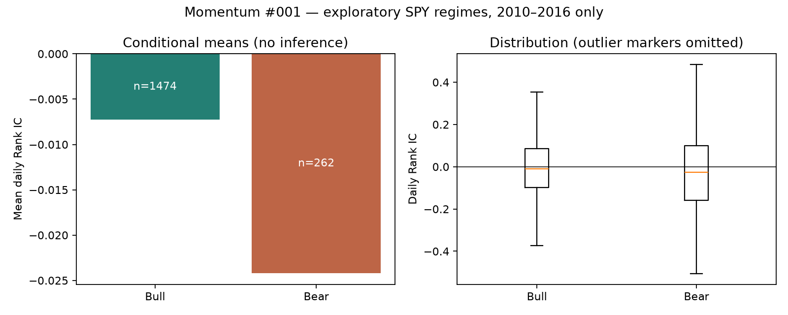
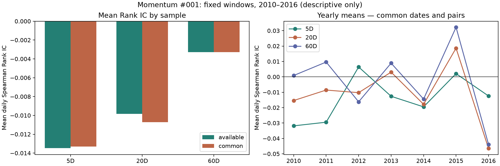
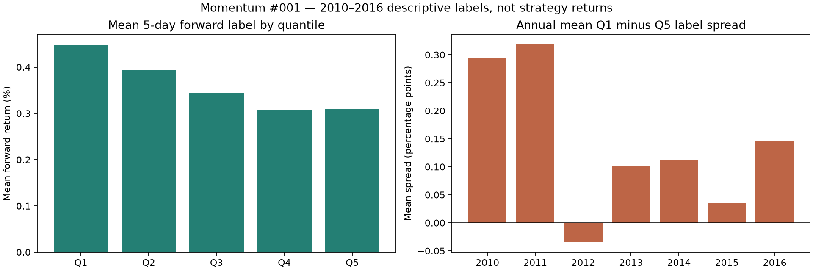

# Momentum Research #001

The original results remain in `research/01_momentum.ipynb`. This report records only the new exploratory appendix.

## Exploratory appendix: SPY market-trend regimes (2010–2016 only)

This fixed-specification extension does not replace prior research results or conclusions.
Raw 20-day Momentum is unchanged. Target: P[t+6]/P[t+1]-1, with at least 100
paired assets per signal date, matching the existing daily Rank IC series.
Equity inputs are sliced to 2010–2016 before computing labels. Both endpoints
must fall inside this period. No 2017–2025 IC values are computed or used.
The initial equity factor warm-up remains unchanged (20 rows in 2010).

SPY adjusted daily Close is obtained through the existing validated loader for
2008-01-01 through 2017-01-01 exclusive, with raw and processed request caches.
Its trailing 200-row arithmetic moving average includes the signal-date close.
Bull means Close > SMA; Bear means Close <= SMA. Labels are known after that
close, consistent with next-row entry. The first 199 rows and windows containing
missing prices are unlabeled; no filling is used. Pre-2010 SPY data warms up
the SMA before labels are aligned by signal date, never by row position.

Included dates: 1736; excluded exploration rows: 26.
Standard deviation uses ddof=1. ICIR is mean/std, unannualized. Positive fraction
is the proportion of valid daily IC values strictly greater than zero.
Yearly counts below refer to included IC observations, not all market sessions.

### Conditional Rank IC

| regime | count | mean | std | icir | positive_fraction |
| --- | --- | --- | --- | --- | --- |
| Bull | 1474.000000 | -0.007281 | 0.146984 | -0.049534 | 0.469471 |
| Bear | 262.000000 | -0.024208 | 0.204916 | -0.118138 | 0.450382 |

### Yearly distribution of included observations

| year | Bull | Bear | total | bull_fraction |
| --- | --- | --- | --- | --- |
| 2010 | 172 | 60 | 232 | 0.741379 |
| 2011 | 160 | 92 | 252 | 0.634921 |
| 2012 | 247 | 3 | 250 | 0.988000 |
| 2013 | 252 | 0 | 252 | 1.000000 |
| 2014 | 247 | 5 | 252 | 0.980159 |
| 2015 | 198 | 54 | 252 | 0.785714 |
| 2016 | 198 | 48 | 246 | 0.804878 |

### Descriptive visualization

### Scope and limitations

These are exploratory conditional descriptions, not a new research conclusion,
an executable strategy, or evidence of statistical significance. Five-day labels
overlap; IC observations and market regimes are serially dependent. No iid tests,
confidence intervals, or significance claims are made. Dependence-aware inference
would be necessary before assessing uncertainty. State counts are unequal.
The 200-day rule was specified in advance here; no thresholds or parameters were
tuned. Current-universe survivorship/selection bias remains. Yahoo adjusted prices
are retrieval-time snapshots subject to revisions and corporate-action adjustments,
not a certified point-in-time archive. Computational labeling uses only rows at or
before the signal date; this cannot remove vendor revision bias.

Structured outputs: `data/research/momentum_001/regime_2010_2016/` contains
daily alignment/inclusion flags, conditional statistics, yearly counts, SPY prices,
SMA/regimes, and methodology metadata. Reproduce with
`python -B scripts/momentum_regime_001.py`; in the notebook pass its existing
endpoint-filtered `daily_ic` to `run(daily_rank_ic=daily_ic)` for alignment verification.

## Pre-specified Window Sensitivity Analysis (2010–2016 only)

### Fixed specification and preservation

Exploration only: 2010-01-01 through 2016-12-31. Lookbacks are exactly 5, 20,
and 60 observed trading rows; no values were tuned or selected after inspecting
results. All call the existing `calculate_momentum` function unchanged:
P[t]/P[t-window]-1, with fill_method=None. The frozen 300-security universe from
`config/universe.csv` is retained, including securities without usable histories.
No prior findings or conclusions are replaced. Validation and held-out test
periods are unchanged; no 2017–2025 IC values are computed or used.

Prices are sliced to exploration before factor/label construction. As in the
existing 20D study, no pre-2010 equity warm-up is added. The shared label is
P[t+6]/P[t+1]-1 (5-day horizon, entry_lag=1). Entry and exit dates must both lie
within exploration; the final six rows cannot contribute. No missing price is
filled. Momentum and returns use observed endpoints, not a requirement that every
intermediate row be nonmissing, preserving the existing factor mathematics.

Rank IC uses pairwise observed factor/return values and at least 100 valid assets.
Average ranks handle ties. Zero-variance cross sections yield undefined IC and
are excluded. Statistics equally weight valid signal dates. Standard deviation
uses ddof=1; ICIR is unannualized mean/std; positive fraction counts IC > 0.
The available-sample 20D daily series matches the prior saved series value by value.

### Available-sample and strict common-sample statistics

Available samples independently use each window's valid ticker/return pairs.
For the common comparison, intersect valid labels and all three factors **per
date and ticker**, recompute ranks/IC on those same pairs, then retain only dates
with defined IC for every window. Merely intersecting dates would not suffice.
This produces 1696 common dates, from
2010-03-31 through 2016-12-21,
with 246–275 identical pairs per date
(446512 date/ticker pairs in total). Both dates and pairs
are identical across windows, although the shared ticker set can vary over time.

| sample | window | count | mean | std | icir | positive_fraction |
| --- | --- | --- | --- | --- | --- | --- |
| available | 5D | 1751 | -0.013475 | 0.148360 | -0.090827 | 0.463735 |
| available | 20D | 1736 | -0.009835 | 0.157147 | -0.062588 | 0.466590 |
| available | 60D | 1696 | -0.003273 | 0.170055 | -0.019249 | 0.509434 |
| common | 5D | 1696 | -0.013309 | 0.150351 | -0.088520 | 0.462854 |
| common | 20D | 1696 | -0.010709 | 0.158450 | -0.067586 | 0.467571 |
| common | 60D | 1696 | -0.003273 | 0.170055 | -0.019249 | 0.509434 |

### Yearly Mean Rank IC

| sample | year | 5D | 20D | 60D |
| --- | --- | --- | --- | --- |
| available | 2010 | -0.026089 | -0.008834 | 0.000862 |
| available | 2011 | -0.030089 | -0.008816 | 0.009600 |
| available | 2012 | 0.006380 | -0.009322 | -0.016237 |
| available | 2013 | -0.012612 | 0.003346 | 0.008886 |
| available | 2014 | -0.020209 | -0.017844 | -0.014442 |
| available | 2015 | 0.001300 | 0.018396 | 0.032206 |
| available | 2016 | -0.013091 | -0.046566 | -0.043874 |
| common | 2010 | -0.031842 | -0.015394 | 0.000862 |
| common | 2011 | -0.029474 | -0.008593 | 0.009600 |
| common | 2012 | 0.006414 | -0.010287 | -0.016237 |
| common | 2013 | -0.012633 | 0.003054 | 0.008886 |
| common | 2014 | -0.019510 | -0.017829 | -0.014442 |
| common | 2015 | 0.002078 | 0.018625 | 0.032206 |
| common | 2016 | -0.012432 | -0.046504 | -0.043874 |

Yearly valid signal-date counts (common counts must match across windows):

| sample | year | 5D | 20D | 60D |
| --- | --- | --- | --- | --- |
| available | 2010 | 247 | 232 | 192 |
| available | 2011 | 252 | 252 | 252 |
| available | 2012 | 250 | 250 | 250 |
| available | 2013 | 252 | 252 | 252 |
| available | 2014 | 252 | 252 | 252 |
| available | 2015 | 252 | 252 | 252 |
| available | 2016 | 246 | 246 | 246 |
| common | 2010 | 192 | 192 | 192 |
| common | 2011 | 252 | 252 | 252 |
| common | 2012 | 250 | 250 | 250 |
| common | 2013 | 252 | 252 | 252 |
| common | 2014 | 252 | 252 | 252 |
| common | 2015 | 252 | 252 | 252 |
| common | 2016 | 246 | 246 | 246 |

### Descriptive visualization

### Limitations and interpretation boundaries

Overlapping 5-day outcomes, overlapping lookbacks, and shared securities create
serial and cross-window dependence. These descriptive summaries and the figure
have no significance tests, confidence intervals, or executable-return claims.
Missing endpoints, IPOs, and longer warm-up requirements change the available
samples. The common sample addresses comparability but conditions on availability
at all three lookbacks and does not remove selection bias. Current constituents
and current sector assignments create survivorship/selection bias; historical
index membership is not reconstructed. Yahoo prices can be revised and adjusted
retrospectively. Comparing three windows and seven yearly slices involves multiple
comparisons, even with a fixed specification. No winning window is selected and
no prior research conclusion is changed. Dependence-aware inference and a separate
validation protocol would be required before stronger claims.

Artifacts: `data/research/momentum_001/window_sensitivity_2010_2016/` contains
`available.csv`, `common.csv` (daily IC), `summary.csv`, `yearly_means.csv`,
`yearly_counts.csv`, `audit.csv` (endpoints, pair counts, date eligibility),
`common_pairs.csv` (exact used Date × Ticker mask), and `methodology.json`
(fixed settings and source hashes). The section is also saved as `section.md`.
Reproduce offline with `python -B scripts/momentum_window_sensitivity_001.py`.
`--append-report` appends once and refuses to overwrite an existing section.

## Exploratory dependence-aware inference (2010–2016 only)

### Scope and pre-specified conventions

Only `data/research/momentum_001/window_sensitivity_2010_2016/common.csv` was
used as the statistical input. No prices, factor matrices, other research IC
series, or validation/test data were read or evaluated. All three windows use
the existing strict common dates and ticker/return pairs. There are 1696
observations, 2010-03-31 through 2016-12-21.
All-missing leading warm-up and trailing endpoint rows are trimmed jointly;
there are no interior excluded rows or partially missing cross-window IC rows.
HAC lags count consecutive saved trading observations, not calendar days.
This verifies continuity within the saved grid, not an independent exchange calendar.
The 5-day prediction horizon and lag-1 entry of the saved results are unchanged.

Primary bandwidth: **5**. Sensitivity bandwidths: **10 and 20**, fixed before
viewing inference. Null hypotheses are mean IC = 0, and mean paired difference = 0.
Each difference is constructed date by date first; its own HAC covariance is
estimated directly. Separate window SEs are not combined as if independent.

For residuals u[t] = IC[t] - mean(IC), Bartlett weights are w[j]=1-j/(L+1).
Cov(mean) = (sum(u[t]^2) + 2 sum(j=1..L) w[j] sum(t=j+1..n) u[t]u[t-j]) / n^2,
multiplied by **n/(n-1)**. This is the n/(n-k) correction for intercept-only OLS
with k=1. Autocovariances use denominator n, not n-j. No annualization is used.
The reported t-statistic is mean/HAC_SE, with an **asymptotic standard-normal**
reference: two-sided p = 2 Phi(-abs(t)); 95% CI = mean +/- 1.959964 HAC_SE.
The finite-sample covariance multiplier does not make this an exact finite-sample
Student-t test. CIs are pointwise, not simultaneous.

Convention references: [statsmodels cov_hac](https://www.statsmodels.org/stable/generated/statsmodels.stats.sandwich_covariance.cov_hac.html)
and [robust covariance inference](https://www.statsmodels.org/stable/generated/statsmodels.regression.linear_model.RegressionResults.get_robustcov_results.html).
The explicit reference configuration is intercept-only OLS followed by
`get_robustcov_results(cov_type="HAC", maxlags=L, kernel="bartlett", use_correction=True, use_t=False)`.

### Numerical verification before interpretation

An independently implemented scalar HAC estimator was compared with statsmodels
0.15.0 on all six actual series at all three lags.
All 126 comparisons (mean, covariance, SE, t, p and CI endpoints)
passed rtol=1e-10, atol=1e-12. Maximum absolute discrepancy:
6.66e-15. Synthetic reference tests also cover
autocorrelation, heteroskedasticity, paired dependence and correction conventions.

### Primary inference: HAC lag 5

| series | lag | n | mean | hac_se | t_stat | p_value | ci_low | ci_high |
| --- | --- | --- | --- | --- | --- | --- | --- | --- |
| 5D | 5 | 1696 | -0.013309 | 0.005847 | -2.276083 | 0.022841 | -0.024770 | -0.001848 |
| 20D | 5 | 1696 | -0.010709 | 0.006870 | -1.558794 | 0.119045 | -0.024174 | 0.002756 |
| 60D | 5 | 1696 | -0.003273 | 0.007422 | -0.441075 | 0.659158 | -0.017819 | 0.011273 |
| 5D minus 20D | 5 | 1696 | -0.002600 | 0.006471 | -0.401776 | 0.687849 | -0.015284 | 0.010084 |
| 5D minus 60D | 5 | 1696 | -0.010036 | 0.007906 | -1.269389 | 0.204302 | -0.025531 | 0.005460 |
| 20D minus 60D | 5 | 1696 | -0.007436 | 0.006050 | -1.229073 | 0.219044 | -0.019293 | 0.004422 |

### Sensitivity: HAC lags 10 and 20

| series | lag | n | mean | hac_se | t_stat | p_value | ci_low | ci_high |
| --- | --- | --- | --- | --- | --- | --- | --- | --- |
| 5D | 10 | 1696 | -0.013309 | 0.005925 | -2.246244 | 0.024688 | -0.024922 | -0.001696 |
| 5D | 20 | 1696 | -0.013309 | 0.006089 | -2.185845 | 0.028827 | -0.025243 | -0.001375 |
| 20D | 10 | 1696 | -0.010709 | 0.007145 | -1.498845 | 0.133914 | -0.024713 | 0.003295 |
| 20D | 20 | 1696 | -0.010709 | 0.007480 | -1.431615 | 0.152254 | -0.025370 | 0.003952 |
| 60D | 10 | 1696 | -0.003273 | 0.007701 | -0.425078 | 0.670780 | -0.018367 | 0.011820 |
| 60D | 20 | 1696 | -0.003273 | 0.007880 | -0.415438 | 0.677821 | -0.018717 | 0.012170 |
| 5D minus 20D | 10 | 1696 | -0.002600 | 0.006960 | -0.373586 | 0.708712 | -0.016241 | 0.011041 |
| 5D minus 20D | 20 | 1696 | -0.002600 | 0.007171 | -0.362552 | 0.716939 | -0.016656 | 0.011456 |
| 5D minus 60D | 10 | 1696 | -0.010036 | 0.008544 | -1.174624 | 0.240145 | -0.026781 | 0.006710 |
| 5D minus 60D | 20 | 1696 | -0.010036 | 0.009226 | -1.087729 | 0.276715 | -0.028118 | 0.008047 |
| 20D minus 60D | 10 | 1696 | -0.007436 | 0.006497 | -1.144375 | 0.252468 | -0.020170 | 0.005299 |
| 20D minus 60D | 20 | 1696 | -0.007436 | 0.007145 | -1.040723 | 0.298004 | -0.021439 | 0.006568 |

### Exploratory threshold sensitivity, not revised research conclusions

The following tracks the nominal unadjusted 0.05 threshold only; it does not
establish a window ranking or confirmatory evidence. A CI including zero does
not demonstrate equivalence or absence of an effect.

- 5D: unadjusted exploratory p < 0.05 at lags 5, 10, 20; p-values at lags 5/10/20 = 0.022841/0.024688/0.028827.
- 20D: unadjusted exploratory p < 0.05 at none of the specified lags; p-values at lags 5/10/20 = 0.119045/0.133914/0.152254.
- 60D: unadjusted exploratory p < 0.05 at none of the specified lags; p-values at lags 5/10/20 = 0.659158/0.670780/0.677821.
- 5D minus 20D: unadjusted exploratory p < 0.05 at none of the specified lags; p-values at lags 5/10/20 = 0.687849/0.708712/0.716939.
- 5D minus 60D: unadjusted exploratory p < 0.05 at none of the specified lags; p-values at lags 5/10/20 = 0.204302/0.240145/0.276715.
- 20D minus 60D: unadjusted exploratory p < 0.05 at none of the specified lags; p-values at lags 5/10/20 = 0.219044/0.252468/0.298004.

The nominal threshold pattern is unchanged across all three lag choices.

### Limitations and confirmatory boundary

These are **exploratory p-values** from an already investigated sample, not
confirmatory evidence. Six hypotheses at three lag choices produce 18 correlated
reported tests, in addition to prior window, yearly and regime explorations.
P-values are unadjusted; intervals do not control familywise coverage. Fixed
bandwidths do not remove multiple-testing or researcher-selection concerns, and
lag sensitivity must not be used to pick a favorable p-value. No winning window
is selected and prior findings/conclusions are preserved.

Newey–West accounts for heteroskedasticity and weighted serial covariance through
the selected lag. It does not guarantee correct coverage under longer dependence,
structural breaks or nonstationarity. Overlapping 5-day labels and momentum
lookbacks can induce dependence beyond lag 5, motivating the specified sensitivity
checks without optimizing them. Changes in the valid ticker set, missing-history
selection, current-universe survivorship bias and vendor revisions remain. HAC
does not correct any of those biases. Confirmatory claims would require a separate
pre-specified hypothesis family, multiplicity handling and validation protocol;
validation and held-out test periods are unchanged and untouched here.

Artifacts under `data/research/momentum_001/hac_2010_2016/`: `hac_results.csv`,
`p_value_sensitivity.csv`, `statsmodels_verification.csv`, `methodology.json`,
and `section.md`. Reproduce offline with `python -B scripts/momentum_hac_001.py`.
`--append-report` appends once without replacing any earlier report text.

## Final exploratory experiment: Quantile Forward Return Analysis (2010–2016)

### Methodology and fixed scope

The frozen 300-security universe is unchanged. Existing local adjusted prices are
sliced to 2010-01-01 through 2016-12-31 **before** any factor or label calculation.
No 2017–2025 factor evaluation results are read or calculated. The existing
`calculate_momentum(prices, window=5)` gives P[t]/P[t-5]-1 with fill_method=None.
The target is `forward_returns(prices, horizon=5, entry_lag=1)`, P[t+6]/P[t+1]-1.
Entry and exit dates must both be in exploration. The first five signal rows
have no factor warm-up and the final six have no complete in-period endpoints.
No pre-2010 equity warm-up is introduced; prior studies and conclusions are preserved.

`quantile_groups` and `quantile_returns` use only same-date observed factor values
to establish membership, **before** excluding missing future returns. Q1 holds
the lowest Momentum and Q5 the highest. The fixed framework rule is
floor((average_rank - 0.5)/observed_factor_count * 5) + 1. Ties stay together,
so group sizes may differ and bins may be empty. Constant cross sections or fewer
than five observed factors remain unassigned. No alternative grouping rules were searched.

Each group's daily mean gives equal weight to its members with observed forward
endpoints; missing-return members remain counted as members but not as observed
returns. Zero members or zero valid returns produce NaN, never zero. At least
one valid return per group is required; no new arbitrary per-group threshold or
the earlier IC-specific 100-asset threshold is added. Counts below disclose small
groups. Missing prices are not filled. Endpoint-based factor/label formulas do
not require every intermediate price to exist. Membership can be recorded on
an endpoint-excluded date, but that date contributes no forward-return statistic.

Daily spread is Q1 mean minus Q5 mean, only when both are defined on the same
signal date. Time summaries equally weight available daily means, not pooled
stock/date observations. `paired_date_mean_return` restricts each group to valid
spread dates; this discloses any denominator difference. Daily membership and
valid-return counts are retained even for excluded dates.

### Quantile mean forward returns

All returns in the tables are decimal fractions (0.01 = 1%). These are overlapping
5-day labels, not daily, annualized, or compounded portfolio returns.

| quantile | mean_return | valid_dates | valid_return_total | paired_date_mean_return |
| --- | --- | --- | --- | --- |
| Q1 | 0.004479 | 1751 | 92214 | 0.004479 |
| Q2 | 0.003934 | 1751 | 92524 | 0.003934 |
| Q3 | 0.003450 | 1751 | 92186 | 0.003450 |
| Q4 | 0.003082 | 1751 | 92530 | 0.003082 |
| Q5 | 0.003093 | 1751 | 92214 | 0.003093 |

### Membership and valid-return counts

Ranges, averages and membership totals below refer to each group's valid-return
signal dates. `valid_return_total` above is the total observed stock/date label
count. Full date-by-group counts, including zero-count dates, are in `daily_quantiles.csv`.

| quantile | membership_total | membership_min | membership_mean | membership_max | valid_returns_min | valid_returns_mean | valid_returns_max |
| --- | --- | --- | --- | --- | --- | --- | --- |
| Q1 | 92214 | 49 | 52.663621 | 55 | 49 | 52.663621 | 55 |
| Q2 | 92524 | 49 | 52.840662 | 56 | 49 | 52.840662 | 56 |
| Q3 | 92186 | 49 | 52.647630 | 56 | 49 | 52.647630 | 56 |
| Q4 | 92530 | 49 | 52.844089 | 56 | 49 | 52.844089 | 56 |
| Q5 | 92214 | 49 | 52.663621 | 55 | 49 | 52.663621 | 55 |

### Primary descriptive contrast: Q1 minus Q5

| contrast | valid_dates | mean_spread | std_daily_spread | positive_spread_fraction |
| --- | --- | --- | --- | --- |
| Q1 minus Q5 | 1751.000000 | 0.001386 | 0.013689 | 0.551114 |

Spread standard deviation uses ddof=1; positive fraction means spread strictly
greater than zero. Valid spread dates: 1751, from
2010-01-11 through 2016-12-21.
Excluded exploration dates: 11. Dates with valid
returns in all five groups: 1751.

### Yearly comparisons and stability

Yearly quantile means (decimal returns):

| year | Q1 | Q2 | Q3 | Q4 | Q5 |
| --- | --- | --- | --- | --- | --- |
| 2010 | 0.006634 | 0.005298 | 0.004586 | 0.003530 | 0.003694 |
| 2011 | 0.003021 | 0.002301 | 0.001785 | 0.001230 | -0.000161 |
| 2012 | 0.004755 | 0.004204 | 0.003869 | 0.004076 | 0.005103 |
| 2013 | 0.007115 | 0.006503 | 0.005949 | 0.005696 | 0.006105 |
| 2014 | 0.004078 | 0.004270 | 0.003352 | 0.002620 | 0.002959 |
| 2015 | 0.000378 | 0.000421 | 0.000408 | 0.000453 | 0.000020 |
| 2016 | 0.005437 | 0.004585 | 0.004242 | 0.004004 | 0.003977 |

Yearly valid-date counts for each quantile:

| year | Q1 | Q2 | Q3 | Q4 | Q5 |
| --- | --- | --- | --- | --- | --- |
| 2010 | 247 | 247 | 247 | 247 | 247 |
| 2011 | 252 | 252 | 252 | 252 | 252 |
| 2012 | 250 | 250 | 250 | 250 | 250 |
| 2013 | 252 | 252 | 252 | 252 | 252 |
| 2014 | 252 | 252 | 252 | 252 | 252 |
| 2015 | 252 | 252 | 252 | 252 | 252 |
| 2016 | 246 | 246 | 246 | 246 | 246 |

Yearly Q1 minus Q5 spread statistics:

| year | valid_dates | mean_spread | std_daily_spread | positive_spread_fraction |
| --- | --- | --- | --- | --- |
| 2010 | 247.000000 | 0.002940 | 0.011903 | 0.578947 |
| 2011 | 252.000000 | 0.003182 | 0.017068 | 0.599206 |
| 2012 | 250.000000 | -0.000348 | 0.012450 | 0.536000 |
| 2013 | 252.000000 | 0.001010 | 0.009524 | 0.551587 |
| 2014 | 252.000000 | 0.001119 | 0.012749 | 0.555556 |
| 2015 | 252.000000 | 0.000358 | 0.014411 | 0.511905 |
| 2016 | 246.000000 | 0.001460 | 0.016058 | 0.524390 |

Annual mean spread magnitudes: 2010: 0.2940 pp, 2011: 0.3182 pp, 2012: -0.0348 pp, 2013: 0.1010 pp, 2014: 0.1119 pp, 2015: 0.0358 pp, 2016: 0.1460 pp. These annual descriptions are
reported without selecting favorable years or changing the specification.

### Descriptive visualizations

### Interpretation and limitations

The summaries describe the association between past 5-day Momentum ranks and
subsequent 5-day labels in this exploratory sample. The Q1-minus-Q5 sign reflects
the difference between low- and high-Momentum group outcomes; it does not prove
tradable reversal, Alpha, a causal effect, or an executable long-short return.
Overall and yearly means should be read alongside dispersion, sign fractions,
and membership/valid-return counts rather than as evidence from independent days.

Forward labels overlap, and lookbacks and observations share dates and securities,
creating serial dependence. No cumulative performance, portfolio backtest,
significance test or confidence interval is produced. Prior HAC results concerned
Rank IC and do not supply inference for these return spreads. Any inference for
spreads would require its own dependence-aware analysis and multiplicity plan.

Missing endpoints, IPOs, unassigned factors and ties can change effective weights
and available samples. Keeping missing-return stocks in membership counts does not
eliminate missing-data selection. Current constituents cause survivorship and
selection bias; this is not historical index membership. Adjusted Yahoo prices
can be revised. No transaction costs, turnover, liquidity, short availability,
execution timing, financing or market/sector-risk adjustment is modeled. Positive
mean group labels may reflect market exposure, not factor Alpha. This is another
exploration on an already examined sample; multiple-comparison concerns remain.
No alternative quantile definitions or parameters were searched, no winning group
or strategy is selected, and existing research conclusions are not modified.
Validation and held-out test datasets remain untouched.

Artifacts under `data/research/momentum_001/quantiles_2010_2016/` include
`group_membership.csv`, `daily_quantiles.csv`, `daily_returns.csv`, `daily_spread.csv`,
`quantile_summary.csv`, `spread_summary.csv`, `yearly_returns.csv`, `yearly_counts.csv`,
`yearly_spreads.csv`, `audit.csv`, `methodology.json` and `section.md`.
Reproduce offline: `python -B scripts/momentum_quantiles_001.py`.
`--append-report` appends once and refuses to replace an existing quantile section.

## Frozen protocol validation execution: 2017–2019 (v1.0.0)

This is the single authorized temporal validation execution, distinct from all
2010–2016 exploration above. Protocol and seal were verified before tests and
execution. No specification was amended. The 5D negative-IC hypothesis was selected
after exploration, not independently pre-specified before it. Validation covers
2017-01-01 through 2019-12-31; no 2020–2025 evaluation outcomes were read or computed.

### Primary outcome and frozen decision

**Decision: Pass**. Frozen primary lower-tail rule applied.

| index | value |
| --- | --- |
| decision | Pass |
| reason | Frozen primary lower-tail rule applied |
| valid_ic_observations | 748 |
| mean_rank_ic | -0.019492862 |
| hac_se | 0.009887328 |
| t_stat | -1.971499421 |
| one_sided_p | 0.024333390 |
| one_sided_upper_95 | -0.003229654 |
| leading_trim | 0 |
| trailing_trim | 6 |
| first_signal | 2017-01-03 |
| last_signal | 2019-12-20 |

The fixed target is P[t+6]/P[t+1]-1, factor is P[t]/P[t-5]-1, min_assets=100.
HAC uses lag 5, Bartlett weights, n/(n-1) correction, and an asymptotic normal
reference. The p-value is norm.cdf(t), one-sided lower tail, not half a two-sided
p-value regardless of sign. The one-sided 95% upper bound uses norm.ppf(0.95).
Only mean<0 AND p<0.05 passes; eligibility failure is Inconclusive. A Not Supported
result does not prove a zero or positive effect, and the hypothesis is not changed.

### Secondary descriptive outcome

| index | value |
| --- | --- |
| valid_dates | 748.000000000 |
| mean_spread | 0.001703055 |
| std_spread | 0.014299343 |
| positive_fraction | 0.545454545 |

| quantile | mean_return | dates | observations | membership_total | members_min | members_mean | members_max | valid_returns_min | valid_returns_mean | valid_returns_max |
| --- | --- | --- | --- | --- | --- | --- | --- | --- | --- | --- |
| 1 | 0.004447649 | 748 | 41617 | 41617 | 54 | 55.637700535 | 57 | 54 | 55.637700535 | 57 |
| 2 | 0.003318539 | 748 | 41648 | 41648 | 54 | 55.679144385 | 57 | 54 | 55.679144385 | 57 |
| 3 | 0.003021896 | 748 | 41765 | 41765 | 55 | 55.835561497 | 58 | 55 | 55.835561497 | 58 |
| 4 | 0.003051545 | 748 | 41649 | 41649 | 54 | 55.680481283 | 58 | 54 | 55.680481283 | 58 |
| 5 | 0.002744594 | 748 | 41620 | 41620 | 54 | 55.641711230 | 57 | 54 | 55.641711230 | 57 |

Returns/spreads are decimal fractions, not percentages. Q1 is lowest Momentum;
Q5 highest. Membership precedes future-label exclusions. Group means use equal
weights over available labels; spread dates require both groups, without applying
the primary 100-asset filter. These descriptions cannot change the primary decision.
No secondary p-values, parameter searches, cumulative returns or backtest were run.

### Coverage, tests and provenance

Five preceding observed price rows warm up the factor, and only validation dates
enter outcomes. Labels extending beyond 2019 are missing; no filling is performed.
Daily exclusions, pair counts, membership and valid-return counts are saved locally.
Input coverage: `{"warmup_dates": ["2016-12-23", "2016-12-27", "2016-12-28", "2016-12-29", "2016-12-30"], "last_price_date": "2019-12-31", "securities": 300, "validation_dates": 754, "entirely_missing_symbols": ["ABNB", "APP", "CARR", "CEG", "COIN", "DASH", "FDXF", "GEHC", "GEV", "HONA", "HOOD", "OTIS", "Q", "RDDT", "SNDK", "SOLV", "VLTO"]}`.
Pre-outcome full pytest suite: `{"tests": 123, "failures": 0, "errors": 0, "skipped": 0}`.
Driver SHA-256: `8c54ef7aad2815671f6a57347951543247488951aad92e89cdbf952491f3130e`.
Protocol SHA-256: `3dac4c7dc3f9b105da885d065f4f3b66471443ad4e4013b10911886d30ed6797`.

Artifacts: `data/validation/momentum_001_v1/` contains the single-use marker,
driver snapshot, preflight log/JUnit/results, daily audits, result tables, execution
metadata and SHA-256 artifact manifest. The exact sealed pre-validation report is
archived as `exploration_report_frozen.md`. Its bytes remain an unchanged prefix
of this report; the original protocol and integrity seal are unchanged.
Because this report was itself frozen, the original strict verifier will now
detect its authorized append. Post-execution auditing verifies the sealed report
archive/prefix separately and all other frozen files normally; the lock is not regenerated.

### Interpretation limits

The reported primary decision applies only to the predeclared directional test
in this frozen current-constituent sample. Exploration-driven selection,
survivorship bias, missing histories, retrospective adjustments, dependence beyond
lag 5 and temporal instability remain limitations. Secondary spreads do not prove
tradability or Alpha. Prior exploration conclusions are preserved. No outcome
authorizes tuning, rerunning this validation, or opening the 2020–2025 held-out period.
